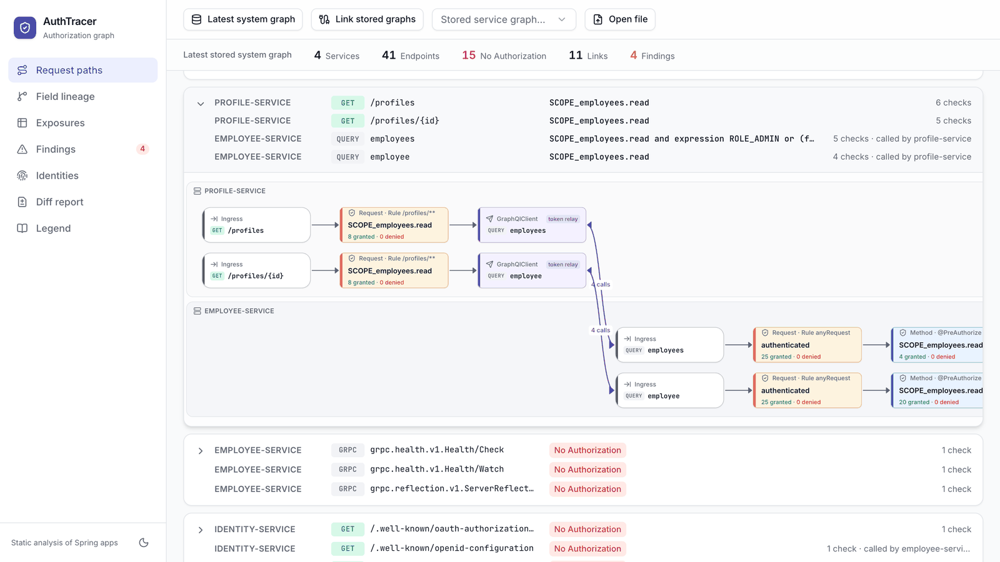

# AuthTracer

AuthTracer shows who can reach what across your Spring services, and fails a pull request that weakens it.

It reads each service's compiled code (no agent, nothing to run), finds every way in, every authorization check and
every call to another service, and puts them in order: the filter chain's rules, method checks, field checks, and the
checks in the services a request calls. Linked together, and confirmed with traces when you have them, the graphs
answer questions such as:

- What does a caller need to get this endpoint, or this one field of its response, through every service on the way?
- Where does this field's value come from, and which checks guard it?
- Which checks are skipped on some path, and which sensitive endpoints answer anyone?
- Does this change make anything reachable with less than before?



**Status.** AuthTracer is an MVP, published as an example. It reads Spring Boot 4.1 and Spring Security 7.1
applications. Read [Known gaps](#known-gaps) before you trust what it says about yours.

## Get started

```
./gradlew bootRun     # the UI on http://localhost:8080 (needs JDK 25 and Node.js 22.13+; the CLI needs only the JDK)
./gradlew authtracer --args="scan --project ../MyService --out build/graphs/myservice.json --publish http://localhost:8080"
```

- **[Tutorial](guide/tutorial.md):** scan the four example services in [`examples/`](examples), link them, follow a
  sensitive field, and fail a pull request, step by step.
- **[Reference](guide/reference.md):** the command line, Gradle tasks, the scanner image (built jars scanned with no
  network: `scripts/scan-artifacts.sh build/libs build/authtracer`), REST API, and the Provided facts file.
- **[Onboarding](guide/onboarding.md):** how AuthTracer works inside, for people changing it.
- **[Codebase guide](guide/codebase/README.md):** where each logic chain lives, from a detector to the UI, and which
  code each feature needs ([feature index](guide/codebase/features.md)).
- **Video tour:** [`guide/video/authtracer-tour.mp4`](guide/video/authtracer-tour.mp4), a 100-second captioned tour of
  the example system; `guide/video/make_video.py` records it again from your own data.
- **Demo:** `scripts/demo.sh` (or the IntelliJ run configuration **demo**) starts the example system (its Kafka and
  RabbitMQ in Docker), scans, sends traffic and links, so the UI has everything to show, and writes two pull-request
  diffs to open in the Diff report view: `build/demo/shortcut-diff.json` and `build/demo/weakened-diff.json`.

## Known gaps

What AuthTracer can't read, or reads wrong, as of this release, worst first. [BUGS.md](BUGS.md) has the known bugs in
detail: where each is, how to confirm it, and which way a fix goes.

**It can show more protection than the application has.** These matter most: the graph asks more of a caller than
Spring does, so the diff can pass a change that weakens access.

- SOAP calls and message sends record no credentials, which reads as passing the caller's token on: a SOAP service's
  checks count for the original caller, endpoint policies follow both into the service called, and no credential
  finding is raised.
- Checks in a `HandlerInterceptor`'s `postHandle` or `afterCompletion` count as guarding the endpoint, although a
  `@ResponseBody` response has been written by then.
- Code that sets the `Authentication` itself is reported, but the checks after it are still read against the caller,
  where Spring decides them on what the code set.
- A filter, provider or other bean made only under a condition (`@Profile("dev")`) is shown running on every request.
  Filter chains and method security follow bean conditions; most other readers don't.
- A field's lineage is followed only so many flows deep. Past that, its sources, labels and field checks aren't
  counted, so the diff doesn't test that field for a new lower-privilege route, and only the server's log says so.

**Versions and configuration.**

- Read: Spring Boot 4.1, Spring Security 7.1, Spring Framework 7.0, `jakarta.*`; Java, Kotlin, and Groovy 4 or later.
  Class files 17, 21 and 25 are tested.
- Not read: Spring Security 5/6-only APIs (`WebSecurityConfigurerAdapter`, `authorizeRequests`, `antMatchers`),
  `javax.*`, Boot 2/3 property names, and Groovy 3's call sites. A Boot 3 application scans, but what it reports is
  unverified.
- Configuration comes from the project's `application.yaml`/`.properties` only: profile documents and environment
  overrides aren't applied, so a deployment's own settings aren't in the graph.

**What it doesn't see.** Each leaves part of an application out of the graph, most without a finding.

- Calls through HTTP clients it doesn't know (OkHttp, Apache HttpClient, Retrofit, the JAX-RS client, WebSocket and
  STOMP clients): no call, no link, no finding.
- A listener whose topic or queue it can't read: a finding, but its handler isn't an entry point, so nothing on its
  path is in the graph.
- Path prefixes from `PathMatchConfigurer#addPathPrefix` and `spring.webflux.base-path`, and class-level mapping
  conditions.
- Bean calls in the SpEL of request and message rules (`access("@guard.check(..)")`).
- The legacy access API (voters, `AccessDecisionManager`, `RunAsManager`), ACL services and ACL writes, and legacy XML
  URL authorization.
- By design, hand-rolled checks (`if (!user.isAdmin()) throw ...`) count as no authorization. They are listed
  separately, as unrecognized check-like code.

**Field lineage has holes, mostly silent:** a field looks like a root, or a link carries no fields.

- Request bodies (HTTP, gRPC, GraphQL arguments, SOAP) and headers carry no lineage into the service called; only
  responses and message payloads do.
- A response read as an array class (`Foo[].class`) is misread: that link carries no fields, and the called
  endpoint's checks don't count across it. A response type handed in (a `Class<T>` parameter or field) isn't followed.
- Not read: Jackson names and shapes set in code (naming-strategy customizers, mixins), `@JsonUnwrapped`,
  `@JsonAlias`, and computed getters.
- Not followed: writes into an argument, values handed between a service's own entry points, and Lombok `@Builder`
  objects. Kotlin's `copy()` credits a property it replaces to both its new and its old value.

**Linking.**

- Traces confirm HTTP, GraphQL, gRPC, Kafka and RabbitMQ links. RSocket, SOAP, STOMP and WebSocket links come from the
  code only. Zipkin's v2 API, or a file of its traces, is the only trace source.
- A host name with dots (a Kubernetes service name, say) is matched by port only, so services that all listen on 8080
  over-link. A base URL it can't read links to every service with the route, and a URL built differently on each
  branch is read with every branch's parts.
- RabbitMQ named exchanges don't link from the code, and gRPC links by method name only.

**The model and the diff.**

- One authority source per service, the stalest way in.
- The diff doesn't compare authority sources, check order, or removed findings.
- Code AuthTracer can't read stays an Opaque node; nothing else tries to read it.
- Testing support (flagging over-scoped test identities) is a rough implementation.

**Running it.**

- The server has no sign-in. It binds 127.0.0.1 unless told otherwise, and it keeps every graph published to it:
  `./data` grows with no retention.
- The scanner image isn't published to a registry: build it with `./gradlew :scanner-image:dockerImage`.

## License

AuthTracer is free software: you can redistribute it and/or modify it under the terms of the GNU General Public
License as published by the Free Software Foundation, either version 3 of the License, or (at your option) any later
version. It is distributed in the hope that it will be useful, but WITHOUT ANY WARRANTY; without even the implied
warranty of MERCHANTABILITY or FITNESS FOR A PARTICULAR PURPOSE. See [LICENSE](LICENSE) for the full text.

The UI bundles the Inter and JetBrains Mono fonts, which are under the SIL Open Font License 1.1.
