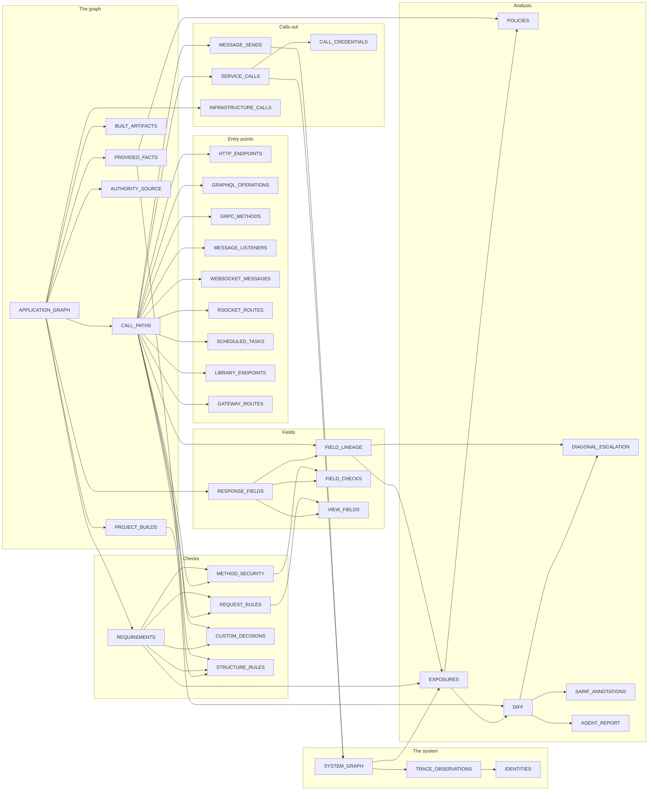

# Feature index

Generated from the `@Supports` annotations in the code and the `// @supports` lines in the UI by
`CodebaseGuideTests`, so don't edit it by hand: after changing them, rewrite it with
`./gradlew test --tests '*CodebaseGuideTests' -PupdateGuide=true`. The links' line anchors are refreshed with `scripts/guide-anchors.sh`.

A feature is anything of value in AuthTracer's response. The catalogue is
[`Feature`](../../annotations/src/main/java/dev/crain/authtracer/annotations/Feature.java#L13): each
feature relies on others, and the code it needs is its own and theirs. The [overview](README.md)
explains how to read and extend it.

| Area | Features |
|---|---|
| [The graph](#the-graph) | [APPLICATION_GRAPH](#application_graph), [PROJECT_BUILDS](#project_builds), [BUILT_ARTIFACTS](#built_artifacts), [PROVIDED_FACTS](#provided_facts), [AUTHORITY_SOURCE](#authority_source), [CALL_PATHS](#call_paths) |
| [Entry points](#entry-points) | [HTTP_ENDPOINTS](#http_endpoints), [GRAPHQL_OPERATIONS](#graphql_operations), [GRPC_METHODS](#grpc_methods), [MESSAGE_LISTENERS](#message_listeners), [WEBSOCKET_MESSAGES](#websocket_messages), [RSOCKET_ROUTES](#rsocket_routes), [SCHEDULED_TASKS](#scheduled_tasks), [LIBRARY_ENDPOINTS](#library_endpoints), [GATEWAY_ROUTES](#gateway_routes) |
| [Checks](#checks) | [REQUIREMENTS](#requirements), [REQUEST_RULES](#request_rules), [METHOD_SECURITY](#method_security), [CUSTOM_DECISIONS](#custom_decisions), [STRUCTURE_RULES](#structure_rules) |
| [Fields](#fields) | [RESPONSE_FIELDS](#response_fields), [FIELD_LINEAGE](#field_lineage), [FIELD_CHECKS](#field_checks), [VIEW_FIELDS](#view_fields) |
| [Calls out](#calls-out) | [SERVICE_CALLS](#service_calls), [MESSAGE_SENDS](#message_sends), [INFRASTRUCTURE_CALLS](#infrastructure_calls), [CALL_CREDENTIALS](#call_credentials) |
| [The system](#the-system) | [SYSTEM_GRAPH](#system_graph), [TRACE_OBSERVATIONS](#trace_observations), [IDENTITIES](#identities) |
| [Findings](#findings) | [FINDING_NOT_ENFORCED](#finding_not_enforced), [FINDING_BYPASSED](#finding_bypassed), [FINDING_UNRECOGNIZED_CHECK](#finding_unrecognized_check), [FINDING_AUTHORITIES_IN_CODE](#finding_authorities_in_code), [FINDING_OPAQUE_CALLPATH](#finding_opaque_callpath), [FINDING_OPAQUE_CONFIG](#finding_opaque_config), [FINDING_CHECK_AFTER_COMMIT](#finding_check_after_commit), [FINDING_ALWAYS_DENIED](#finding_always_denied), [FINDING_ALWAYS_GRANTED](#finding_always_granted), [FINDING_OPEN_SENSITIVE_ENDPOINT](#finding_open_sensitive_endpoint), [FINDING_PROVIDED_CONFLICT](#finding_provided_conflict), [FINDING_RUNTIME_ONLY_CHECK](#finding_runtime_only_check), [FINDING_UNMATCHED_CALL](#finding_unmatched_call), [FINDING_TOKEN_REJECTED](#finding_token_rejected) |
| [Analysis](#analysis) | [EXPOSURES](#exposures), [POLICIES](#policies), [DIFF](#diff), [DIAGONAL_ESCALATION](#diagonal_escalation), [SARIF_ANNOTATIONS](#sarif_annotations), [AGENT_REPORT](#agent_report) |
| [Delivery](#delivery) | [COMMAND_LINE](#command_line), [SCANNER_IMAGE](#scanner_image), [GRAPH_SERVER](#graph_server), [UI](#ui), [PATHS_VIEW](#paths_view), [LINEAGE_VIEW](#lineage_view), [EXPOSURES_VIEW](#exposures_view), [FINDINGS_VIEW](#findings_view), [IDENTITIES_VIEW](#identities_view), [DIFF_VIEW](#diff_view), [LEGEND_VIEW](#legend_view) |

## How the features depend on each other

Each arrow runs from a feature to one that relies on it. Findings and delivery are left out to keep it
readable: their sections below say what each relies on.

## The graph

### APPLICATION_GRAPH

One service's authorization graph as a scan writes it: its entry points, checks, calls, fields and findings, in JSON that compares cleanly between revisions.

- **Described in:** [scanning.md: The scan](scanning.md#the-scan), [scanning.md: The graph model](scanning.md#the-graph-model)
- **Relies on:** nothing else
- **Relied on by:** [PROJECT_BUILDS](#project_builds), [BUILT_ARTIFACTS](#built_artifacts), [PROVIDED_FACTS](#provided_facts), [AUTHORITY_SOURCE](#authority_source), [CALL_PATHS](#call_paths), [REQUIREMENTS](#requirements), [RESPONSE_FIELDS](#response_fields), [INFRASTRUCTURE_CALLS](#infrastructure_calls), [FINDING_OPAQUE_CONFIG](#finding_opaque_config), [COMMAND_LINE](#command_line)
- **Code:**
  - `graph/`: [`ApplicationGraph`](../../scanner/src/main/java/dev/crain/authtracer/graph/ApplicationGraph.java#L21), [`AuthoritySource`](../../scanner/src/main/java/dev/crain/authtracer/graph/AuthoritySource.java#L24), [`AuthorizationLocation`](../../scanner/src/main/java/dev/crain/authtracer/graph/AuthorizationLocation.java#L30), [`CodeRef`](../../scanner/src/main/java/dev/crain/authtracer/graph/CodeRef.java#L12), [`Credentials`](../../scanner/src/main/java/dev/crain/authtracer/graph/Credentials.java#L11), [`Edge`](../../scanner/src/main/java/dev/crain/authtracer/graph/Edge.java#L23), [`Egress`](../../scanner/src/main/java/dev/crain/authtracer/graph/Egress.java#L24), [`FieldSource`](../../scanner/src/main/java/dev/crain/authtracer/graph/FieldSource.java#L10), [`Field`](../../scanner/src/main/java/dev/crain/authtracer/graph/Field.java#L25), [`Finding`](../../scanner/src/main/java/dev/crain/authtracer/graph/Finding.java#L12), [`Flow`](../../scanner/src/main/java/dev/crain/authtracer/graph/Flow.java#L19), [`GraphJson`](../../scanner/src/main/java/dev/crain/authtracer/graph/GraphJson.java#L25), [`Ingress`](../../scanner/src/main/java/dev/crain/authtracer/graph/Ingress.java#L25), [`Issuer`](../../scanner/src/main/java/dev/crain/authtracer/graph/Issuer.java#L24), [`Node`](../../scanner/src/main/java/dev/crain/authtracer/graph/Node.java#L17), [`Opaque`](../../scanner/src/main/java/dev/crain/authtracer/graph/Opaque.java#L11), [`Payload`](../../scanner/src/main/java/dev/crain/authtracer/graph/Payload.java#L17), [`ProvidedFact`](../../scanner/src/main/java/dev/crain/authtracer/graph/ProvidedFact.java#L26), [`Registration`](../../scanner/src/main/java/dev/crain/authtracer/graph/Registration.java#L23), [`Requirement`](../../scanner/src/main/java/dev/crain/authtracer/graph/Requirement.java#L25)
  - `scan/`: [`Annotations`](../../scanner/src/main/java/dev/crain/authtracer/scan/Annotations.java#L20), [`ApplicationScanner`](../../scanner/src/main/java/dev/crain/authtracer/scan/ApplicationScanner.java#L39), [`ClassFileMetadata`](../../scanner/src/main/java/dev/crain/authtracer/scan/ClassFileMetadata.java#L53), [`ConfigurationProperties`](../../scanner/src/main/java/dev/crain/authtracer/scan/ConfigurationProperties.java#L37), [`EnclosingMethods`](../../scanner/src/main/java/dev/crain/authtracer/scan/EnclosingMethods.java#L32), [`FrameworkModule`](../../scanner/src/main/java/dev/crain/authtracer/scan/FrameworkModule.java#L11), [`GraphBuilder`](../../scanner/src/main/java/dev/crain/authtracer/scan/GraphBuilder.java#L26), [`GroovyCalls`](../../scanner/src/main/java/dev/crain/authtracer/scan/GroovyCalls.java#L27), [`Locals`](../../scanner/src/main/java/dev/crain/authtracer/scan/Locals.java#L29), [`MethodNames`](../../scanner/src/main/java/dev/crain/authtracer/scan/MethodNames.java#L17), [`OrderedMembers`](../../scanner/src/main/java/dev/crain/authtracer/scan/OrderedMembers.java#L30), [`ProjectScans.defaultScanner`](../../scanner/src/main/java/dev/crain/authtracer/scan/ProjectScans.java#L34), [`ScanContext`](../../scanner/src/main/java/dev/crain/authtracer/scan/ScanContext.java#L31), [`ScanInput`](../../scanner/src/main/java/dev/crain/authtracer/scan/ScanInput.java#L20), [`TypeRelations`](../../scanner/src/main/java/dev/crain/authtracer/scan/TypeRelations.java#L25)
  - `scan/spring/`: [`BeanConditions`](../../scanner/src/main/java/dev/crain/authtracer/scan/spring/BeanConditions.java#L47), [`SpringBeans`](../../scanner/src/main/java/dev/crain/authtracer/scan/spring/SpringBeans.java#L27), [`SpringNames`](../../scanner/src/main/java/dev/crain/authtracer/scan/spring/SpringNames.java#L13), [`SpringSecurityModule`](../../scanner/src/main/java/dev/crain/authtracer/scan/spring/SpringSecurityModule.java#L60)

### PROJECT_BUILDS

Scanning a Gradle or Maven project by its directory: its classes, libraries and configuration, compiled first when needed.

- **Described in:** [scanning.md: Scanning a project](scanning.md#scanning-a-project)
- **Relies on:** [APPLICATION_GRAPH](#application_graph)
- **Relied on by:** [DIFF](#diff), [COMMAND_LINE](#command_line)
- **Code:**
  - `scan/`: [`GitWorktree`](../../scanner/src/main/java/dev/crain/authtracer/scan/GitWorktree.java#L22), [`Processes`](../../scanner/src/main/java/dev/crain/authtracer/scan/Processes.java#L22), [`ProjectScans`](../../scanner/src/main/java/dev/crain/authtracer/scan/ProjectScans.java#L24)
  - `scan/build/`: [`BuildClasspath`](../../scanner/src/main/java/dev/crain/authtracer/scan/build/BuildClasspath.java#L13), [`Builds`](../../scanner/src/main/java/dev/crain/authtracer/scan/build/Builds.java#L15), [`GradleProject`](../../scanner/src/main/java/dev/crain/authtracer/scan/build/GradleProject.java#L26), [`MavenProject`](../../scanner/src/main/java/dev/crain/authtracer/scan/build/MavenProject.java#L24)

### BUILT_ARTIFACTS

Scanning a built Spring Boot jar or war: unpacked, never run, into its classes, libraries and configuration, its service and revision read from what the build recorded.

- **Described in:** [scanning.md: Scanning a built artifact](scanning.md#scanning-a-built-artifact)
- **Relies on:** [APPLICATION_GRAPH](#application_graph)
- **Relied on by:** [SCANNER_IMAGE](#scanner_image)
- **Code:**
  - `scan/`: [`ArtifactScans`](../../scanner/src/main/java/dev/crain/authtracer/scan/ArtifactScans.java#L40)

### PROVIDED_FACTS

What people tell the scan in authtracer.yaml and the organisation's facts file: sensitive fields, declassified ones, reviewed hand-rolled checks, requirements enforced outside the code; the organisation's facts win.

- **Described in:** [analysis.md: Provided facts](analysis.md#provided-facts)
- **Relies on:** [APPLICATION_GRAPH](#application_graph)
- **Relied on by:** [STRUCTURE_RULES](#structure_rules), [FINDING_PROVIDED_CONFLICT](#finding_provided_conflict), [POLICIES](#policies)
- **Code:**
  - `graph/`: [`Field.declassify`](../../scanner/src/main/java/dev/crain/authtracer/graph/Field.java#L93), [`Field.withLabels`](../../scanner/src/main/java/dev/crain/authtracer/graph/Field.java#L80), [`ProvidedFact`](../../scanner/src/main/java/dev/crain/authtracer/graph/ProvidedFact.java#L26)
  - `provided/`: [`ProvidedFacts`](../../scanner/src/main/java/dev/crain/authtracer/provided/ProvidedFacts.java#L34)
  - `scan/`: [`ApplicationScanner.applyFieldFacts`](../../scanner/src/main/java/dev/crain/authtracer/scan/ApplicationScanner.java#L181), [`ApplicationScanner.unmatchedFacts`](../../scanner/src/main/java/dev/crain/authtracer/scan/ApplicationScanner.java#L138), [`GraphBuilder.provided`](../../scanner/src/main/java/dev/crain/authtracer/scan/GraphBuilder.java#L176)
  - `scan/spring/`: [`HttpSecurityRules.Matcher`](../../scanner/src/main/java/dev/crain/authtracer/scan/spring/HttpSecurityRules.java#L101), [`MethodSecurity.providedCheck`](../../scanner/src/main/java/dev/crain/authtracer/scan/spring/MethodSecurity.java#L875), [`SpringSecurityModule.providedRequirements`](../../scanner/src/main/java/dev/crain/authtracer/scan/spring/SpringSecurityModule.java#L1146), [`SpringSecurityModule.requestChecks`](../../scanner/src/main/java/dev/crain/authtracer/scan/spring/SpringSecurityModule.java#L1035)

### AUTHORITY_SOURCE

Where a service's authorities come from (JWT claims, token introspection, UserDetails, a login's identity provider, WS-Security, a filter's own code) and how fresh they are, and the checks that read a live source of their own.

- **Described in:** [requirements.md: Where the authorities come from](requirements.md#where-the-authorities-come-from), [rules.md: SOAP and WS-Security](rules.md#soap-and-ws-security)
- **Relies on:** [APPLICATION_GRAPH](#application_graph)
- **Relied on by:** [FINDING_AUTHORITIES_IN_CODE](#finding_authorities_in_code), [FINDING_ALWAYS_DENIED](#finding_always_denied)
- **Code:**
  - `graph/`: [`AuthoritySource`](../../scanner/src/main/java/dev/crain/authtracer/graph/AuthoritySource.java#L24), [`AuthorizationLocation.withFreshness`](../../scanner/src/main/java/dev/crain/authtracer/graph/AuthorizationLocation.java#L70)
  - `scan/`: [`GraphBuilder.authoritySource`](../../scanner/src/main/java/dev/crain/authtracer/scan/GraphBuilder.java#L156)
  - `scan/spring/`: [`AuthenticationMechanisms`](../../scanner/src/main/java/dev/crain/authtracer/scan/spring/AuthenticationMechanisms.java#L43), [`AuthenticationProviders`](../../scanner/src/main/java/dev/crain/authtracer/scan/spring/AuthenticationProviders.java#L44), [`BuiltValues`](../../scanner/src/main/java/dev/crain/authtracer/scan/spring/BuiltValues.java#L40), [`ContextRepositories`](../../scanner/src/main/java/dev/crain/authtracer/scan/spring/ContextRepositories.java#L46), [`DecisionCode.report`](../../scanner/src/main/java/dev/crain/authtracer/scan/spring/DecisionCode.java#L128), [`FilterAuthentication`](../../scanner/src/main/java/dev/crain/authtracer/scan/spring/FilterAuthentication.java#L38), [`JwtSettings`](../../scanner/src/main/java/dev/crain/authtracer/scan/spring/JwtSettings.java#L77), [`RequestFilters.Library`](../../scanner/src/main/java/dev/crain/authtracer/scan/spring/RequestFilters.java#L227), [`RequestFilters.authenticating`](../../scanner/src/main/java/dev/crain/authtracer/scan/spring/RequestFilters.java#L355), [`RequestFilters.beforeRule`](../../scanner/src/main/java/dev/crain/authtracer/scan/spring/RequestFilters.java#L378), [`RequestFilters.filters`](../../scanner/src/main/java/dev/crain/authtracer/scan/spring/RequestFilters.java#L344), [`RequestFilters.library`](../../scanner/src/main/java/dev/crain/authtracer/scan/spring/RequestFilters.java#L510), [`SecurityXml`](../../scanner/src/main/java/dev/crain/authtracer/scan/spring/SecurityXml.java#L45), [`WsSecurity`](../../scanner/src/main/java/dev/crain/authtracer/scan/spring/WsSecurity.java#L35), [`new SpringSecurityModule.Scan`](../../scanner/src/main/java/dev/crain/authtracer/scan/spring/SpringSecurityModule.java#L86)

### CALL_PATHS

Each entry point's steps in the order they run: filters, rules, interceptors, then what the handler reaches through proxies, other threads and branches only some returns take.

- **Described in:** [call-paths.md: Call paths](call-paths.md#call-paths), [scanning.md: Groovy and Kotlin calls](scanning.md#groovy-and-kotlin-calls)
- **Relies on:** [APPLICATION_GRAPH](#application_graph)
- **Relied on by:** [HTTP_ENDPOINTS](#http_endpoints), [GRAPHQL_OPERATIONS](#graphql_operations), [GRPC_METHODS](#grpc_methods), [MESSAGE_LISTENERS](#message_listeners), [WEBSOCKET_MESSAGES](#websocket_messages), [RSOCKET_ROUTES](#rsocket_routes), [SCHEDULED_TASKS](#scheduled_tasks), [LIBRARY_ENDPOINTS](#library_endpoints), [GATEWAY_ROUTES](#gateway_routes), [REQUEST_RULES](#request_rules), [METHOD_SECURITY](#method_security), [CUSTOM_DECISIONS](#custom_decisions), [STRUCTURE_RULES](#structure_rules), [FIELD_LINEAGE](#field_lineage), [SERVICE_CALLS](#service_calls), [MESSAGE_SENDS](#message_sends), [FINDING_BYPASSED](#finding_bypassed), [FINDING_UNRECOGNIZED_CHECK](#finding_unrecognized_check), [FINDING_AUTHORITIES_IN_CODE](#finding_authorities_in_code), [FINDING_OPAQUE_CALLPATH](#finding_opaque_callpath), [FINDING_ALWAYS_DENIED](#finding_always_denied), [PATHS_VIEW](#paths_view)
- **Code:**
  - `graph/`: [`ApplicationGraph.path`](../../scanner/src/main/java/dev/crain/authtracer/graph/ApplicationGraph.java#L73), [`Edge`](../../scanner/src/main/java/dev/crain/authtracer/graph/Edge.java#L23)
  - `scan/`: [`Branches`](../../scanner/src/main/java/dev/crain/authtracer/scan/Branches.java#L32), [`CallTraversal`](../../scanner/src/main/java/dev/crain/authtracer/scan/CallTraversal.java#L44), [`GraphBuilder.Split`](../../scanner/src/main/java/dev/crain/authtracer/scan/GraphBuilder.java#L62), [`GraphBuilder.split`](../../scanner/src/main/java/dev/crain/authtracer/scan/GraphBuilder.java#L76), [`GraphBuilder.splits`](../../scanner/src/main/java/dev/crain/authtracer/scan/GraphBuilder.java#L86), [`GroovyCalls.receiverClass`](../../scanner/src/main/java/dev/crain/authtracer/scan/GroovyCalls.java#L95), [`GroovyCalls.target`](../../scanner/src/main/java/dev/crain/authtracer/scan/GroovyCalls.java#L63), [`GroovyTypedCalls`](../../scanner/src/main/java/dev/crain/authtracer/scan/GroovyTypedCalls.java#L70)
  - `scan/spring/`: [`AsyncCalls`](../../scanner/src/main/java/dev/crain/authtracer/scan/spring/AsyncCalls.java#L66), [`FilterChainCalls`](../../scanner/src/main/java/dev/crain/authtracer/scan/spring/FilterChainCalls.java#L26), [`HttpClientEgress.constant`](../../scanner/src/main/java/dev/crain/authtracer/scan/spring/HttpClientEgress.java#L812), [`HttpSecurityRules.Matcher`](../../scanner/src/main/java/dev/crain/authtracer/scan/spring/HttpSecurityRules.java#L101), [`HttpSecurityRules.chainsFor`](../../scanner/src/main/java/dev/crain/authtracer/scan/spring/HttpSecurityRules.java#L906), [`NoCaller`](../../scanner/src/main/java/dev/crain/authtracer/scan/spring/NoCaller.java#L28), [`PathTail`](../../scanner/src/main/java/dev/crain/authtracer/scan/spring/PathTail.java#L15), [`RequestFilters`](../../scanner/src/main/java/dev/crain/authtracer/scan/spring/RequestFilters.java#L66), [`RequestMappings.Mapping`](../../scanner/src/main/java/dev/crain/authtracer/scan/spring/RequestMappings.java#L45), [`RequestMappings.unique`](../../scanner/src/main/java/dev/crain/authtracer/scan/spring/RequestMappings.java#L331), [`ServletEndpoints.mappings`](../../scanner/src/main/java/dev/crain/authtracer/scan/spring/ServletEndpoints.java#L344), [`SpringBeans`](../../scanner/src/main/java/dev/crain/authtracer/scan/spring/SpringBeans.java#L27), [`SpringSecurityModule.RequestPath`](../../scanner/src/main/java/dev/crain/authtracer/scan/spring/SpringSecurityModule.java#L1172), [`SpringSecurityModule`](../../scanner/src/main/java/dev/crain/authtracer/scan/spring/SpringSecurityModule.java#L60), [`WebStack`](../../scanner/src/main/java/dev/crain/authtracer/scan/spring/WebStack.java#L38), [`WebXml`](../../scanner/src/main/java/dev/crain/authtracer/scan/spring/WebXml.java#L30)

## Entry points

### HTTP_ENDPOINTS

HTTP endpoints: annotated controllers, functional routes, JAX-RS resources, servlets, SOAP operations and the repositories Spring Data REST exports.

- **Described in:** [entry-points.md: HTTP endpoints](entry-points.md#http-endpoints)
- **Relies on:** [CALL_PATHS](#call_paths)
- **Relied on by:** nothing else
- **Code:**
  - `graph/`: [`Ingress.andParams`](../../scanner/src/main/java/dev/crain/authtracer/graph/Ingress.java#L104), [`Ingress.withParams`](../../scanner/src/main/java/dev/crain/authtracer/graph/Ingress.java#L94)
  - `scan/spring/`: [`DataRestRepositories`](../../scanner/src/main/java/dev/crain/authtracer/scan/spring/DataRestRepositories.java#L51), [`FunctionalEndpoints`](../../scanner/src/main/java/dev/crain/authtracer/scan/spring/FunctionalEndpoints.java#L66), [`JaxRsResources`](../../scanner/src/main/java/dev/crain/authtracer/scan/spring/JaxRsResources.java#L38), [`RequestMappings`](../../scanner/src/main/java/dev/crain/authtracer/scan/spring/RequestMappings.java#L29), [`ServletEndpoints`](../../scanner/src/main/java/dev/crain/authtracer/scan/spring/ServletEndpoints.java#L47), [`SoapEndpoints`](../../scanner/src/main/java/dev/crain/authtracer/scan/spring/SoapEndpoints.java#L40), [`SpringSecurityModule.Scan.entryPoints`](../../scanner/src/main/java/dev/crain/authtracer/scan/spring/SpringSecurityModule.java#L303), [`SpringSecurityModule.Scan.withHead`](../../scanner/src/main/java/dev/crain/authtracer/scan/spring/SpringSecurityModule.java#L382), [`SpringSecurityModule.alternatives`](../../scanner/src/main/java/dev/crain/authtracer/scan/spring/SpringSecurityModule.java#L1051)

### GRAPHQL_OPERATIONS

GraphQL queries, mutations, subscriptions and field resolvers, over HTTP and WebSocket, with the fields the schema has.

- **Described in:** [entry-points.md: GraphQL operations](entry-points.md#graphql-operations)
- **Relies on:** [CALL_PATHS](#call_paths)
- **Relied on by:** nothing else
- **Code:**
  - `graph/`: [`Ingress.graphQlOperation`](../../scanner/src/main/java/dev/crain/authtracer/graph/Ingress.java#L112)
  - `scan/flow/`: [`ResponseFields.resolved`](../../scanner/src/main/java/dev/crain/authtracer/scan/flow/ResponseFields.java#L77)
  - `scan/spring/`: [`GraphQlDocuments.tokenize`](../../scanner/src/main/java/dev/crain/authtracer/scan/spring/GraphQlDocuments.java#L155), [`GraphQlFieldPaths`](../../scanner/src/main/java/dev/crain/authtracer/scan/spring/GraphQlFieldPaths.java#L33), [`GraphQlMappings`](../../scanner/src/main/java/dev/crain/authtracer/scan/spring/GraphQlMappings.java#L35), [`GraphQlSchema`](../../scanner/src/main/java/dev/crain/authtracer/scan/spring/GraphQlSchema.java#L30), [`SpringSecurityModule.Scan.entryPoints`](../../scanner/src/main/java/dev/crain/authtracer/scan/spring/SpringSecurityModule.java#L303), [`SpringSecurityModule.Scan.graphQlResolvers`](../../scanner/src/main/java/dev/crain/authtracer/scan/spring/SpringSecurityModule.java#L791), [`SpringSecurityModule.alternatives`](../../scanner/src/main/java/dev/crain/authtracer/scan/spring/SpringSecurityModule.java#L1051)

### GRPC_METHODS

gRPC service methods, on their own server or through the servlet container.

- **Described in:** [entry-points.md: gRPC methods](entry-points.md#grpc-methods)
- **Relies on:** [CALL_PATHS](#call_paths)
- **Relied on by:** nothing else
- **Code:**
  - `scan/spring/`: [`GrpcServices`](../../scanner/src/main/java/dev/crain/authtracer/scan/spring/GrpcServices.java#L40), [`SpringSecurityModule.Scan.entryPoints`](../../scanner/src/main/java/dev/crain/authtracer/scan/spring/SpringSecurityModule.java#L303)

### MESSAGE_LISTENERS

Kafka, RabbitMQ and JMS listeners and Spring Cloud Stream functions, which run without a caller.

- **Described in:** [entry-points.md: Message listeners](entry-points.md#message-listeners)
- **Relies on:** [CALL_PATHS](#call_paths)
- **Relied on by:** nothing else
- **Code:**
  - `scan/spring/`: [`MessageListeners`](../../scanner/src/main/java/dev/crain/authtracer/scan/spring/MessageListeners.java#L31), [`MessagePayloads`](../../scanner/src/main/java/dev/crain/authtracer/scan/spring/MessagePayloads.java#L38), [`NoCaller`](../../scanner/src/main/java/dev/crain/authtracer/scan/spring/NoCaller.java#L28), [`SpringSecurityModule.Scan.entryPoints`](../../scanner/src/main/java/dev/crain/authtracer/scan/spring/SpringSecurityModule.java#L303), [`StreamFunctions`](../../scanner/src/main/java/dev/crain/authtracer/scan/spring/StreamFunctions.java#L42)

### WEBSOCKET_MESSAGES

STOMP messages and subscriptions (with what the application pushes to their destinations) and plain WebSocket handlers, behind their handshake.

- **Described in:** [entry-points.md: WebSocket messages](entry-points.md#websocket-messages)
- **Relies on:** [CALL_PATHS](#call_paths)
- **Relied on by:** nothing else
- **Code:**
  - `graph/`: [`Ingress.withOtherResponse`](../../scanner/src/main/java/dev/crain/authtracer/graph/Ingress.java#L57)
  - `scan/flow/`: [`GenericTypes`](../../scanner/src/main/java/dev/crain/authtracer/scan/flow/GenericTypes.java#L36)
  - `scan/spring/`: [`NoCaller`](../../scanner/src/main/java/dev/crain/authtracer/scan/spring/NoCaller.java#L28), [`SecurityXml`](../../scanner/src/main/java/dev/crain/authtracer/scan/spring/SecurityXml.java#L45), [`SpringSecurityModule.Scan.entryPoints`](../../scanner/src/main/java/dev/crain/authtracer/scan/spring/SpringSecurityModule.java#L303), [`SpringSecurityModule.Scan.stompBroadcasts`](../../scanner/src/main/java/dev/crain/authtracer/scan/spring/SpringSecurityModule.java#L770), [`SpringSecurityModule.handshakeChecks`](../../scanner/src/main/java/dev/crain/authtracer/scan/spring/SpringSecurityModule.java#L1021), [`SpringSecurityModule.messageChecks`](../../scanner/src/main/java/dev/crain/authtracer/scan/spring/SpringSecurityModule.java#L1001), [`StompMappings`](../../scanner/src/main/java/dev/crain/authtracer/scan/spring/StompMappings.java#L36), [`WebSocketHandlers`](../../scanner/src/main/java/dev/crain/authtracer/scan/spring/WebSocketHandlers.java#L47)

### RSOCKET_ROUTES

RSocket routes, behind their connection's setup.

- **Described in:** [entry-points.md: RSocket routes](entry-points.md#rsocket-routes)
- **Relies on:** [CALL_PATHS](#call_paths)
- **Relied on by:** nothing else
- **Code:**
  - `scan/spring/`: [`RSocketMappings`](../../scanner/src/main/java/dev/crain/authtracer/scan/spring/RSocketMappings.java#L27), [`SpringSecurityModule.Scan.entryPoints`](../../scanner/src/main/java/dev/crain/authtracer/scan/spring/SpringSecurityModule.java#L303)

### SCHEDULED_TASKS

Scheduled tasks and the event listeners they publish to, which run without a caller.

- **Described in:** [entry-points.md: Scheduled tasks](entry-points.md#scheduled-tasks)
- **Relies on:** [CALL_PATHS](#call_paths)
- **Relied on by:** nothing else
- **Code:**
  - `scan/spring/`: [`NoCaller`](../../scanner/src/main/java/dev/crain/authtracer/scan/spring/NoCaller.java#L28), [`ScheduledTasks`](../../scanner/src/main/java/dev/crain/authtracer/scan/spring/ScheduledTasks.java#L20), [`SpringSecurityModule.Scan.entryPoints`](../../scanner/src/main/java/dev/crain/authtracer/scan/spring/SpringSecurityModule.java#L303)

### LIBRARY_ENDPOINTS

Endpoints a library serves: Actuator, an authorization server, a resource server's metadata, a config server, a Eureka server, the H2 console and other library servlets, API docs, GraphiQL, gRPC reflection and health.

- **Described in:** [entry-points.md: Library endpoints](entry-points.md#library-endpoints)
- **Relies on:** [CALL_PATHS](#call_paths)
- **Relied on by:** [FINDING_OPEN_SENSITIVE_ENDPOINT](#finding_open_sensitive_endpoint)
- **Code:**
  - `scan/spring/`: [`ActuatorEndpoints`](../../scanner/src/main/java/dev/crain/authtracer/scan/spring/ActuatorEndpoints.java#L40), [`ApiDocsEndpoints`](../../scanner/src/main/java/dev/crain/authtracer/scan/spring/ApiDocsEndpoints.java#L20), [`AuthenticationMechanisms.bootResourceServerChain`](../../scanner/src/main/java/dev/crain/authtracer/scan/spring/AuthenticationMechanisms.java#L481), [`AuthorizationServerEndpoints`](../../scanner/src/main/java/dev/crain/authtracer/scan/spring/AuthorizationServerEndpoints.java#L41), [`ConfigServerEndpoints`](../../scanner/src/main/java/dev/crain/authtracer/scan/spring/ConfigServerEndpoints.java#L23), [`EurekaServerEndpoints`](../../scanner/src/main/java/dev/crain/authtracer/scan/spring/EurekaServerEndpoints.java#L20), [`GraphQlTools`](../../scanner/src/main/java/dev/crain/authtracer/scan/spring/GraphQlTools.java#L19), [`GrpcServices.library`](../../scanner/src/main/java/dev/crain/authtracer/scan/spring/GrpcServices.java#L110), [`GrpcServices.registeredByHand`](../../scanner/src/main/java/dev/crain/authtracer/scan/spring/GrpcServices.java#L142), [`RequestMappings.mappingInfo`](../../scanner/src/main/java/dev/crain/authtracer/scan/spring/RequestMappings.java#L250), [`RequestMappings.prefixes`](../../scanner/src/main/java/dev/crain/authtracer/scan/spring/RequestMappings.java#L181), [`ResourceServerMetadata`](../../scanner/src/main/java/dev/crain/authtracer/scan/spring/ResourceServerMetadata.java#L33), [`SecurityDsl.authorizationServerEndpoints`](../../scanner/src/main/java/dev/crain/authtracer/scan/spring/SecurityDsl.java#L1606), [`ServletEndpoints.library`](../../scanner/src/main/java/dev/crain/authtracer/scan/spring/ServletEndpoints.java#L206), [`ServletEndpoints.registered`](../../scanner/src/main/java/dev/crain/authtracer/scan/spring/ServletEndpoints.java#L170), [`SpringSecurityModule.Scan.authorizationServers`](../../scanner/src/main/java/dev/crain/authtracer/scan/spring/SpringSecurityModule.java#L747), [`SpringSecurityModule.Scan.entryPoints`](../../scanner/src/main/java/dev/crain/authtracer/scan/spring/SpringSecurityModule.java#L303), [`SpringSecurityModule.Scan.libraryEndpoints`](../../scanner/src/main/java/dev/crain/authtracer/scan/spring/SpringSecurityModule.java#L702), [`SpringSecurityModule.Scan.withFilters`](../../scanner/src/main/java/dev/crain/authtracer/scan/spring/SpringSecurityModule.java#L732)

### GATEWAY_ROUTES

Spring Cloud Gateway routes, forwarded on after the gateway's own rules.

- **Described in:** [entry-points.md: Gateway routes](entry-points.md#gateway-routes)
- **Relies on:** [CALL_PATHS](#call_paths)
- **Relied on by:** nothing else
- **Code:**
  - `scan/spring/`: [`ConfiguredValues`](../../scanner/src/main/java/dev/crain/authtracer/scan/spring/ConfiguredValues.java#L37), [`GatewayRoutes`](../../scanner/src/main/java/dev/crain/authtracer/scan/spring/GatewayRoutes.java#L51), [`HttpClientEgress.textParts`](../../scanner/src/main/java/dev/crain/authtracer/scan/spring/HttpClientEgress.java#L1348), [`SpringSecurityModule.Scan.gatewayRoutes`](../../scanner/src/main/java/dev/crain/authtracer/scan/spring/SpringSecurityModule.java#L685)

## Checks

### REQUIREMENTS

What each check asks for, in one normalized form: SpEL reduced to authorities, role prefixes, the role hierarchy, additional factors, what callers who haven't signed in hold, and what an expression reads besides authorities (method parameters and what the request binds into them, token claims).

- **Described in:** [requirements.md: What a check asks for](requirements.md#what-a-check-asks-for)
- **Relies on:** [APPLICATION_GRAPH](#application_graph)
- **Relied on by:** [REQUEST_RULES](#request_rules), [METHOD_SECURITY](#method_security), [CUSTOM_DECISIONS](#custom_decisions), [STRUCTURE_RULES](#structure_rules), [FINDING_ALWAYS_DENIED](#finding_always_denied), [FINDING_ALWAYS_GRANTED](#finding_always_granted), [EXPOSURES](#exposures)
- **Code:**
  - `graph/`: [`Requirement`](../../scanner/src/main/java/dev/crain/authtracer/graph/Requirement.java#L25)
  - `scan/`: [`OpaqueCode`](../../scanner/src/main/java/dev/crain/authtracer/scan/OpaqueCode.java#L33)
  - `scan/spring/`: [`AnonymousAuthentication`](../../scanner/src/main/java/dev/crain/authtracer/scan/spring/AnonymousAuthentication.java#L45), [`AuthorizationManagerFactories`](../../scanner/src/main/java/dev/crain/authtracer/scan/spring/AuthorizationManagerFactories.java#L43), [`BuiltInManagers`](../../scanner/src/main/java/dev/crain/authtracer/scan/spring/BuiltInManagers.java#L21), [`ExpressionHandlers`](../../scanner/src/main/java/dev/crain/authtracer/scan/spring/ExpressionHandlers.java#L36), [`ExpressionReads`](../../scanner/src/main/java/dev/crain/authtracer/scan/spring/ExpressionReads.java#L45), [`HttpSecurityRules.hierarchyAware`](../../scanner/src/main/java/dev/crain/authtracer/scan/spring/HttpSecurityRules.java#L1146), [`MultiFactor`](../../scanner/src/main/java/dev/crain/authtracer/scan/spring/MultiFactor.java#L43), [`RoleHierarchies`](../../scanner/src/main/java/dev/crain/authtracer/scan/spring/RoleHierarchies.java#L45), [`SecurityDsl.factorsCall`](../../scanner/src/main/java/dev/crain/authtracer/scan/spring/SecurityDsl.java#L1784), [`SecurityDsl.multiFactor`](../../scanner/src/main/java/dev/crain/authtracer/scan/spring/SecurityDsl.java#L1759), [`SpelRequirements`](../../scanner/src/main/java/dev/crain/authtracer/scan/spring/SpelRequirements.java#L33), [`SpringSecurityModule.Scan.hierarchiesAndFactories`](../../scanner/src/main/java/dev/crain/authtracer/scan/spring/SpringSecurityModule.java#L807), [`SpringSecurityModule.Scan.prePost`](../../scanner/src/main/java/dev/crain/authtracer/scan/spring/SpringSecurityModule.java#L280), [`SpringSecurityModule.rebuildSplits`](../../scanner/src/main/java/dev/crain/authtracer/scan/spring/SpringSecurityModule.java#L1078), [`XmlReferences.attributes`](../../scanner/src/main/java/dev/crain/authtracer/scan/spring/XmlReferences.java#L156)

### REQUEST_RULES

The filter chain's rules on each entry point, in the order Spring tries them: the Java, Kotlin and XML configuration, Boot's default chains, and the gRPC, message and RSocket rules.

- **Described in:** [rules.md: HTTP request rules](rules.md#http-request-rules), [rules.md: Protocol rules: gRPC, STOMP and RSocket](rules.md#protocol-rules-grpc-stomp-and-rsocket), [rules.md: SOAP and WS-Security](rules.md#soap-and-ws-security)
- **Relies on:** [CALL_PATHS](#call_paths), [REQUIREMENTS](#requirements)
- **Relied on by:** [VIEW_FIELDS](#view_fields), [FINDING_NOT_ENFORCED](#finding_not_enforced), [FINDING_OPEN_SENSITIVE_ENDPOINT](#finding_open_sensitive_endpoint)
- **Code:**
  - `scan/`: [`GraphBuilder.Split`](../../scanner/src/main/java/dev/crain/authtracer/scan/GraphBuilder.java#L62), [`GraphBuilder.split`](../../scanner/src/main/java/dev/crain/authtracer/scan/GraphBuilder.java#L76), [`GraphBuilder.splits`](../../scanner/src/main/java/dev/crain/authtracer/scan/GraphBuilder.java#L86)
  - `scan/spring/`: [`ActuatorEndpoints`](../../scanner/src/main/java/dev/crain/authtracer/scan/spring/ActuatorEndpoints.java#L40), [`GrpcSecurityRules`](../../scanner/src/main/java/dev/crain/authtracer/scan/spring/GrpcSecurityRules.java#L38), [`GrpcServices.serviceNames`](../../scanner/src/main/java/dev/crain/authtracer/scan/spring/GrpcServices.java#L84), [`HttpSecurityRules`](../../scanner/src/main/java/dev/crain/authtracer/scan/spring/HttpSecurityRules.java#L51), [`MatcherLambdas`](../../scanner/src/main/java/dev/crain/authtracer/scan/spring/MatcherLambdas.java#L53), [`MessageSecurityRules`](../../scanner/src/main/java/dev/crain/authtracer/scan/spring/MessageSecurityRules.java#L55), [`RSocketSecurityRules`](../../scanner/src/main/java/dev/crain/authtracer/scan/spring/RSocketSecurityRules.java#L53), [`SecurityDsl`](../../scanner/src/main/java/dev/crain/authtracer/scan/spring/SecurityDsl.java#L68), [`SecurityXml`](../../scanner/src/main/java/dev/crain/authtracer/scan/spring/SecurityXml.java#L45), [`SpringSecurityModule.EntryRules`](../../scanner/src/main/java/dev/crain/authtracer/scan/spring/SpringSecurityModule.java#L937), [`SpringSecurityModule.Scan.withHead`](../../scanner/src/main/java/dev/crain/authtracer/scan/spring/SpringSecurityModule.java#L382), [`SpringSecurityModule.alternatives`](../../scanner/src/main/java/dev/crain/authtracer/scan/spring/SpringSecurityModule.java#L1051), [`SpringSecurityModule.handshakeChecks`](../../scanner/src/main/java/dev/crain/authtracer/scan/spring/SpringSecurityModule.java#L1021), [`SpringSecurityModule.messageChecks`](../../scanner/src/main/java/dev/crain/authtracer/scan/spring/SpringSecurityModule.java#L1001), [`SpringSecurityModule.requestChecks`](../../scanner/src/main/java/dev/crain/authtracer/scan/spring/SpringSecurityModule.java#L1035), [`WebStack`](../../scanner/src/main/java/dev/crain/authtracer/scan/spring/WebStack.java#L38), [`XmlReferences`](../../scanner/src/main/java/dev/crain/authtracer/scan/spring/XmlReferences.java#L33)

### METHOD_SECURITY

Method checks (@PreAuthorize and its kin, @Secured, JSR-250, XML, custom advisors and pointcuts) where a Spring proxy applies them, where a call skips the proxy, Jersey's @RolesAllowed, and Spring Data queries that filter rows by the caller.

- **Described in:** [method-checks.md: Method security](method-checks.md#method-security)
- **Relies on:** [CALL_PATHS](#call_paths), [REQUIREMENTS](#requirements)
- **Relied on by:** [FIELD_CHECKS](#field_checks), [FINDING_NOT_ENFORCED](#finding_not_enforced), [FINDING_CHECK_AFTER_COMMIT](#finding_check_after_commit)
- **Code:**
  - `graph/`: [`AuthorizationLocation.Argument`](../../scanner/src/main/java/dev/crain/authtracer/graph/AuthorizationLocation.java#L105), [`AuthorizationLocation.withReads`](../../scanner/src/main/java/dev/crain/authtracer/graph/AuthorizationLocation.java#L79)
  - `scan/`: [`ClassFileMetadata.declaredParameterNames`](../../scanner/src/main/java/dev/crain/authtracer/scan/ClassFileMetadata.java#L458)
  - `scan/spring/`: [`AutoProxyCreators`](../../scanner/src/main/java/dev/crain/authtracer/scan/spring/AutoProxyCreators.java#L15), [`CustomAdvisors`](../../scanner/src/main/java/dev/crain/authtracer/scan/spring/CustomAdvisors.java#L42), [`ExpressionHandlers`](../../scanner/src/main/java/dev/crain/authtracer/scan/spring/ExpressionHandlers.java#L36), [`JaxRsResources.jerseyCheck`](../../scanner/src/main/java/dev/crain/authtracer/scan/spring/JaxRsResources.java#L162), [`MethodAdvisors`](../../scanner/src/main/java/dev/crain/authtracer/scan/spring/MethodAdvisors.java#L51), [`MethodSecurity`](../../scanner/src/main/java/dev/crain/authtracer/scan/spring/MethodSecurity.java#L56), [`Pointcuts`](../../scanner/src/main/java/dev/crain/authtracer/scan/spring/Pointcuts.java#L25), [`Proxies`](../../scanner/src/main/java/dev/crain/authtracer/scan/spring/Proxies.java#L48), [`ProxyFactories`](../../scanner/src/main/java/dev/crain/authtracer/scan/spring/ProxyFactories.java#L49), [`SecurityXml`](../../scanner/src/main/java/dev/crain/authtracer/scan/spring/SecurityXml.java#L45), [`SpringBeans`](../../scanner/src/main/java/dev/crain/authtracer/scan/spring/SpringBeans.java#L27), [`SpringSecurityModule.RequestPath`](../../scanner/src/main/java/dev/crain/authtracer/scan/spring/SpringSecurityModule.java#L1172), [`XmlMethodChecks`](../../scanner/src/main/java/dev/crain/authtracer/scan/spring/XmlMethodChecks.java#L45), [`XmlReferences`](../../scanner/src/main/java/dev/crain/authtracer/scan/spring/XmlReferences.java#L33)

### CUSTOM_DECISIONS

Checks decided by application code (custom AuthorizationManagers, SpEL beans, PermissionEvaluators, checks the code makes itself), shown with what that code reads and calls.

- **Described in:** [method-checks.md: Custom decisions](method-checks.md#custom-decisions)
- **Relies on:** [REQUIREMENTS](#requirements), [CALL_PATHS](#call_paths)
- **Relied on by:** nothing else
- **Code:**
  - `graph/`: [`Requirement.custom`](../../scanner/src/main/java/dev/crain/authtracer/graph/Requirement.java#L116), [`Requirement.decidedBy`](../../scanner/src/main/java/dev/crain/authtracer/graph/Requirement.java#L124), [`Requirement.withCode`](../../scanner/src/main/java/dev/crain/authtracer/graph/Requirement.java#L132)
  - `scan/`: [`OpaqueCode`](../../scanner/src/main/java/dev/crain/authtracer/scan/OpaqueCode.java#L33)
  - `scan/spring/`: [`DecisionBodies`](../../scanner/src/main/java/dev/crain/authtracer/scan/spring/DecisionBodies.java#L54), [`DecisionCode`](../../scanner/src/main/java/dev/crain/authtracer/scan/spring/DecisionCode.java#L54), [`ExpressionHandlers.root`](../../scanner/src/main/java/dev/crain/authtracer/scan/spring/ExpressionHandlers.java#L169), [`MessageSecurityRules.evaluate`](../../scanner/src/main/java/dev/crain/authtracer/scan/spring/MessageSecurityRules.java#L336), [`MethodAdvisors.evaluate`](../../scanner/src/main/java/dev/crain/authtracer/scan/spring/MethodAdvisors.java#L353), [`MethodAdvisors.injected`](../../scanner/src/main/java/dev/crain/authtracer/scan/spring/MethodAdvisors.java#L511), [`MethodSecurity.permissionEvaluator`](../../scanner/src/main/java/dev/crain/authtracer/scan/spring/MethodSecurity.java#L281), [`PermissionEvaluators`](../../scanner/src/main/java/dev/crain/authtracer/scan/spring/PermissionEvaluators.java#L32), [`ProgrammaticChecks`](../../scanner/src/main/java/dev/crain/authtracer/scan/spring/ProgrammaticChecks.java#L56), [`RSocketSecurityRules.evaluate`](../../scanner/src/main/java/dev/crain/authtracer/scan/spring/RSocketSecurityRules.java#L245), [`SecurityDsl.customManager`](../../scanner/src/main/java/dev/crain/authtracer/scan/spring/SecurityDsl.java#L644), [`SecurityDsl.injectedManager`](../../scanner/src/main/java/dev/crain/authtracer/scan/spring/SecurityDsl.java#L635), [`SpelRequirements.withBeans`](../../scanner/src/main/java/dev/crain/authtracer/scan/spring/SpelRequirements.java#L81), [`SpelRequirements.withRoot`](../../scanner/src/main/java/dev/crain/authtracer/scan/spring/SpelRequirements.java#L91), [`SpringSecurityModule.RequestPath.onCallSite`](../../scanner/src/main/java/dev/crain/authtracer/scan/spring/SpringSecurityModule.java#L1514), [`SpringSecurityModule.Scan.decisionCalls`](../../scanner/src/main/java/dev/crain/authtracer/scan/spring/SpringSecurityModule.java#L525), [`SpringSecurityModule.Scan.hasPermission`](../../scanner/src/main/java/dev/crain/authtracer/scan/spring/SpringSecurityModule.java#L840), [`XmlReferences.manager`](../../scanner/src/main/java/dev/crain/authtracer/scan/spring/XmlReferences.java#L82)

### STRUCTURE_RULES

Checks of an authorization library AuthTracer doesn't know, described by their shape in authtracer.yaml: an annotation, or a call to one of its methods, and the requirement it enforces, filled from the annotation's attributes or the call's arguments.

- **Described in:** [method-checks.md: Structure rules](method-checks.md#structure-rules)
- **Relies on:** [PROVIDED_FACTS](#provided_facts), [REQUIREMENTS](#requirements), [CALL_PATHS](#call_paths)
- **Relied on by:** nothing else
- **Code:**
  - `provided/`: [`ProvidedFacts.rules`](../../scanner/src/main/java/dev/crain/authtracer/provided/ProvidedFacts.java#L173)
  - `scan/spring/`: [`StructureRules`](../../scanner/src/main/java/dev/crain/authtracer/scan/spring/StructureRules.java#L50)

## Fields

### RESPONSE_FIELDS

The fields of each response and message, as JSON writes them (Jackson's visibility, @JsonView, GraphQL's schema).

- **Described in:** [fields.md: Response fields](fields.md#response-fields)
- **Relies on:** [APPLICATION_GRAPH](#application_graph)
- **Relied on by:** [FIELD_LINEAGE](#field_lineage), [FIELD_CHECKS](#field_checks), [VIEW_FIELDS](#view_fields)
- **Code:**
  - `graph/`: [`Field`](../../scanner/src/main/java/dev/crain/authtracer/graph/Field.java#L25), [`Payload`](../../scanner/src/main/java/dev/crain/authtracer/graph/Payload.java#L17)
  - `scan/`: [`ClassFileMetadata.fields`](../../scanner/src/main/java/dev/crain/authtracer/scan/ClassFileMetadata.java#L316), [`ClassFileMetadata.getters`](../../scanner/src/main/java/dev/crain/authtracer/scan/ClassFileMetadata.java#L248), [`ClassFileMetadata.property`](../../scanner/src/main/java/dev/crain/authtracer/scan/ClassFileMetadata.java#L422), [`ClassFileMetadata.recordComponents`](../../scanner/src/main/java/dev/crain/authtracer/scan/ClassFileMetadata.java#L225)
  - `scan/flow/`: [`GenericTypes`](../../scanner/src/main/java/dev/crain/authtracer/scan/flow/GenericTypes.java#L36), [`Payloads`](../../scanner/src/main/java/dev/crain/authtracer/scan/flow/Payloads.java#L20), [`ResponseFields`](../../scanner/src/main/java/dev/crain/authtracer/scan/flow/ResponseFields.java#L23), [`TypeProperties`](../../scanner/src/main/java/dev/crain/authtracer/scan/flow/TypeProperties.java#L32)
  - `scan/spring/`: [`GraphQlSchema`](../../scanner/src/main/java/dev/crain/authtracer/scan/spring/GraphQlSchema.java#L30), [`SpringSecurityModule.Scan.stompBroadcasts`](../../scanner/src/main/java/dev/crain/authtracer/scan/spring/SpringSecurityModule.java#L770), [`SpringSecurityModule.Scan.walk`](../../scanner/src/main/java/dev/crain/authtracer/scan/spring/SpringSecurityModule.java#L426), [`SpringSecurityModule.jsonViews`](../../scanner/src/main/java/dev/crain/authtracer/scan/spring/SpringSecurityModule.java#L921)

### FIELD_LINEAGE

Where each field's value comes from (Direct, Complex, Computed, Masked), inside a service and across the calls and messages between services.

- **Described in:** [fields.md: Field lineage](fields.md#field-lineage), [scanning.md: Groovy and Kotlin calls](scanning.md#groovy-and-kotlin-calls)
- **Relies on:** [RESPONSE_FIELDS](#response_fields), [CALL_PATHS](#call_paths)
- **Relied on by:** [EXPOSURES](#exposures), [DIAGONAL_ESCALATION](#diagonal_escalation), [LINEAGE_VIEW](#lineage_view)
- **Code:**
  - `graph/`: [`ApplicationGraph.flows`](../../scanner/src/main/java/dev/crain/authtracer/graph/ApplicationGraph.java#L81), [`Egress.withRequest`](../../scanner/src/main/java/dev/crain/authtracer/graph/Egress.java#L93), [`FieldSource`](../../scanner/src/main/java/dev/crain/authtracer/graph/FieldSource.java#L10), [`Flow`](../../scanner/src/main/java/dev/crain/authtracer/graph/Flow.java#L19), [`Ingress.withRequest`](../../scanner/src/main/java/dev/crain/authtracer/graph/Ingress.java#L79)
  - `link/`: [`Linker.Run.networkFlows`](../../src/main/java/dev/crain/authtracer/link/Linker.java#L1067)
  - `scan/`: [`GraphBuilder.flow`](../../scanner/src/main/java/dev/crain/authtracer/scan/GraphBuilder.java#L138), [`GroovyTypedCalls`](../../scanner/src/main/java/dev/crain/authtracer/scan/GroovyTypedCalls.java#L70)
  - `scan/flow/`: [`Payloads`](../../scanner/src/main/java/dev/crain/authtracer/scan/flow/Payloads.java#L20), [`ResponseFields`](../../scanner/src/main/java/dev/crain/authtracer/scan/flow/ResponseFields.java#L23), [`Shape`](../../scanner/src/main/java/dev/crain/authtracer/scan/flow/Shape.java#L18), [`ValueFlow`](../../scanner/src/main/java/dev/crain/authtracer/scan/flow/ValueFlow.java#L64)
  - `scan/spring/`: [`HttpClientEgress.graphQlResponse`](../../scanner/src/main/java/dev/crain/authtracer/scan/spring/HttpClientEgress.java#L776), [`HttpClientEgress.payload`](../../scanner/src/main/java/dev/crain/authtracer/scan/spring/HttpClientEgress.java#L1178), [`HttpClientEgress.response`](../../scanner/src/main/java/dev/crain/authtracer/scan/spring/HttpClientEgress.java#L507), [`HttpClientEgress.rsocketResponse`](../../scanner/src/main/java/dev/crain/authtracer/scan/spring/HttpClientEgress.java#L749), [`MessageListeners.payload`](../../scanner/src/main/java/dev/crain/authtracer/scan/spring/MessageListeners.java#L214), [`MessageListeners.request`](../../scanner/src/main/java/dev/crain/authtracer/scan/spring/MessageListeners.java#L181), [`MessagePayloads`](../../scanner/src/main/java/dev/crain/authtracer/scan/spring/MessagePayloads.java#L38), [`MessageSends.payload`](../../scanner/src/main/java/dev/crain/authtracer/scan/spring/MessageSends.java#L110), [`MessageSends.request`](../../scanner/src/main/java/dev/crain/authtracer/scan/spring/MessageSends.java#L131), [`MethodSecurity.denialHandler`](../../scanner/src/main/java/dev/crain/authtracer/scan/spring/MethodSecurity.java#L1196), [`SpringSecurityModule.RequestPath.onCallSite`](../../scanner/src/main/java/dev/crain/authtracer/scan/spring/SpringSecurityModule.java#L1514), [`SpringSecurityModule.Scan.walk`](../../scanner/src/main/java/dev/crain/authtracer/scan/spring/SpringSecurityModule.java#L426), [`StreamFunctions.carried`](../../scanner/src/main/java/dev/crain/authtracer/scan/spring/StreamFunctions.java#L185)

### FIELD_CHECKS

Checks on single fields of a response, and what a denied caller gets in their place.

- **Described in:** [fields.md: Field checks: the fields side](fields.md#field-checks-the-fields-side), [method-checks.md: Field checks: the method-security side](method-checks.md#field-checks-the-method-security-side)
- **Relies on:** [RESPONSE_FIELDS](#response_fields), [METHOD_SECURITY](#method_security)
- **Relied on by:** [LINEAGE_VIEW](#lineage_view)
- **Code:**
  - `diff/`: [`Exposures.PathChecks.throwing`](../../src/main/java/dev/crain/authtracer/diff/Exposures.java#L288), [`Exposures.notHandedOut`](../../src/main/java/dev/crain/authtracer/diff/Exposures.java#L248)
  - `graph/`: [`AuthorizationLocation.guardedField`](../../scanner/src/main/java/dev/crain/authtracer/graph/AuthorizationLocation.java#L89)
  - `scan/flow/`: [`ResponseFields.denied`](../../scanner/src/main/java/dev/crain/authtracer/scan/flow/ResponseFields.java#L96), [`ValueFlow.derivesFrom`](../../scanner/src/main/java/dev/crain/authtracer/scan/flow/ValueFlow.java#L174)
  - `scan/spring/`: [`CustomAdvisors`](../../scanner/src/main/java/dev/crain/authtracer/scan/spring/CustomAdvisors.java#L42), [`GraphQlFieldPaths.resolverSteps`](../../scanner/src/main/java/dev/crain/authtracer/scan/spring/GraphQlFieldPaths.java#L116), [`MethodSecurity`](../../scanner/src/main/java/dev/crain/authtracer/scan/spring/MethodSecurity.java#L56), [`Proxies`](../../scanner/src/main/java/dev/crain/authtracer/scan/spring/Proxies.java#L48), [`ProxyFactories`](../../scanner/src/main/java/dev/crain/authtracer/scan/spring/ProxyFactories.java#L49), [`SpringSecurityModule.RequestPath.fieldChecks`](../../scanner/src/main/java/dev/crain/authtracer/scan/spring/SpringSecurityModule.java#L1376), [`SpringSecurityModule.Scan.deniedValues`](../../scanner/src/main/java/dev/crain/authtracer/scan/spring/SpringSecurityModule.java#L554), [`SpringSecurityModule.Scan.derivingCheck`](../../scanner/src/main/java/dev/crain/authtracer/scan/spring/SpringSecurityModule.java#L569), [`SpringSecurityModule.Scan.walk`](../../scanner/src/main/java/dev/crain/authtracer/scan/spring/SpringSecurityModule.java#L426), [`SpringSecurityModule.serialized`](../../scanner/src/main/java/dev/crain/authtracer/scan/spring/SpringSecurityModule.java#L1108)

### VIEW_FIELDS

Server-rendered views (Thymeleaf, JSP, FreeMarker): the model fields a page shows, and the guards around them.

- **Described in:** [fields.md: View fields](fields.md#view-fields)
- **Relies on:** [RESPONSE_FIELDS](#response_fields), [REQUEST_RULES](#request_rules)
- **Relied on by:** nothing else
- **Code:**
  - `scan/flow/`: [`GenericTypes`](../../scanner/src/main/java/dev/crain/authtracer/scan/flow/GenericTypes.java#L36)
  - `scan/spring/`: [`FreeMarkerMarkup`](../../scanner/src/main/java/dev/crain/authtracer/scan/spring/FreeMarkerMarkup.java#L21), [`SecurityXml`](../../scanner/src/main/java/dev/crain/authtracer/scan/spring/SecurityXml.java#L45), [`SpelRequirements.standard`](../../scanner/src/main/java/dev/crain/authtracer/scan/spring/SpelRequirements.java#L99), [`SpringSecurityModule.Scan.walk`](../../scanner/src/main/java/dev/crain/authtracer/scan/spring/SpringSecurityModule.java#L426), [`ViewFields`](../../scanner/src/main/java/dev/crain/authtracer/scan/spring/ViewFields.java#L45), [`ViewModels`](../../scanner/src/main/java/dev/crain/authtracer/scan/spring/ViewModels.java#L45), [`ViewTemplates`](../../scanner/src/main/java/dev/crain/authtracer/scan/spring/ViewTemplates.java#L42)

## Calls out

### SERVICE_CALLS

Calls to other services: RestClient, WebClient, RestTemplate, HTTP interfaces, OpenFeign, the JDK's HttpClient, gRPC stubs, GraphQL and SOAP clients, RSocket requesters.

- **Described in:** [calls.md: Service calls](calls.md#service-calls), [scanning.md: Groovy and Kotlin calls](scanning.md#groovy-and-kotlin-calls)
- **Relies on:** [CALL_PATHS](#call_paths)
- **Relied on by:** [CALL_CREDENTIALS](#call_credentials), [SYSTEM_GRAPH](#system_graph)
- **Code:**
  - `graph/`: [`Egress`](../../scanner/src/main/java/dev/crain/authtracer/graph/Egress.java#L24)
  - `scan/`: [`GroovyTypedCalls`](../../scanner/src/main/java/dev/crain/authtracer/scan/GroovyTypedCalls.java#L70)
  - `scan/spring/`: [`AbsoluteUrl`](../../scanner/src/main/java/dev/crain/authtracer/scan/spring/AbsoluteUrl.java#L19), [`ConfiguredValues`](../../scanner/src/main/java/dev/crain/authtracer/scan/spring/ConfiguredValues.java#L37), [`DecisionCode.deciders`](../../scanner/src/main/java/dev/crain/authtracer/scan/spring/DecisionCode.java#L398), [`GraphQlDocuments.tokenize`](../../scanner/src/main/java/dev/crain/authtracer/scan/spring/GraphQlDocuments.java#L155), [`GraphQlDocuments`](../../scanner/src/main/java/dev/crain/authtracer/scan/spring/GraphQlDocuments.java#L16), [`GrpcServices.stubCall`](../../scanner/src/main/java/dev/crain/authtracer/scan/spring/GrpcServices.java#L192), [`HttpClientEgress.constant`](../../scanner/src/main/java/dev/crain/authtracer/scan/spring/HttpClientEgress.java#L812), [`HttpClientEgress.detect`](../../scanner/src/main/java/dev/crain/authtracer/scan/spring/HttpClientEgress.java#L296), [`HttpClientEgress.textParts`](../../scanner/src/main/java/dev/crain/authtracer/scan/spring/HttpClientEgress.java#L1348), [`HttpClientEgress`](../../scanner/src/main/java/dev/crain/authtracer/scan/spring/HttpClientEgress.java#L77), [`RequestMappings.mappingInfo`](../../scanner/src/main/java/dev/crain/authtracer/scan/spring/RequestMappings.java#L250), [`SoapCalls`](../../scanner/src/main/java/dev/crain/authtracer/scan/spring/SoapCalls.java#L37), [`SpringSecurityModule.RequestPath.onCallSite`](../../scanner/src/main/java/dev/crain/authtracer/scan/spring/SpringSecurityModule.java#L1514), [`SpringSecurityModule.Scan.decisionCalls`](../../scanner/src/main/java/dev/crain/authtracer/scan/spring/SpringSecurityModule.java#L525), [`UnreadCalls`](../../scanner/src/main/java/dev/crain/authtracer/scan/spring/UnreadCalls.java#L34)

### MESSAGE_SENDS

Messages sent to topics and queues (Kafka, RabbitMQ, JMS, Stream bridges), with what they carry.

- **Described in:** [calls.md: Message sends](calls.md#message-sends)
- **Relies on:** [CALL_PATHS](#call_paths)
- **Relied on by:** [SYSTEM_GRAPH](#system_graph)
- **Code:**
  - `graph/`: [`Egress`](../../scanner/src/main/java/dev/crain/authtracer/graph/Egress.java#L24)
  - `scan/spring/`: [`ConfiguredValues`](../../scanner/src/main/java/dev/crain/authtracer/scan/spring/ConfiguredValues.java#L37), [`HttpClientEgress.detect`](../../scanner/src/main/java/dev/crain/authtracer/scan/spring/HttpClientEgress.java#L296), [`MessagePayloads`](../../scanner/src/main/java/dev/crain/authtracer/scan/spring/MessagePayloads.java#L38), [`MessageSends`](../../scanner/src/main/java/dev/crain/authtracer/scan/spring/MessageSends.java#L31), [`SpringSecurityModule.RequestPath.onCallSite`](../../scanner/src/main/java/dev/crain/authtracer/scan/spring/SpringSecurityModule.java#L1514), [`SpringSecurityModule.Scan.walk`](../../scanner/src/main/java/dev/crain/authtracer/scan/spring/SpringSecurityModule.java#L426), [`StreamFunctions`](../../scanner/src/main/java/dev/crain/authtracer/scan/spring/StreamFunctions.java#L42), [`UnreadCalls`](../../scanner/src/main/java/dev/crain/authtracer/scan/spring/UnreadCalls.java#L34)

### INFRASTRUCTURE_CALLS

Calls a service makes off its request paths: to its authorization server (issuer, keys, token introspection, token endpoint), its config server and Eureka.

- **Described in:** [calls.md: Infrastructure calls](calls.md#infrastructure-calls)
- **Relies on:** [APPLICATION_GRAPH](#application_graph)
- **Relied on by:** nothing else
- **Code:**
  - `graph/`: [`Egress`](../../scanner/src/main/java/dev/crain/authtracer/graph/Egress.java#L24)
  - `scan/spring/`: [`AbsoluteUrl`](../../scanner/src/main/java/dev/crain/authtracer/scan/spring/AbsoluteUrl.java#L19), [`IdentityProviderCalls`](../../scanner/src/main/java/dev/crain/authtracer/scan/spring/IdentityProviderCalls.java#L33), [`InfrastructureCalls`](../../scanner/src/main/java/dev/crain/authtracer/scan/spring/InfrastructureCalls.java#L24), [`SpringSecurityModule.Scan.run`](../../scanner/src/main/java/dev/crain/authtracer/scan/spring/SpringSecurityModule.java#L221)

### CALL_CREDENTIALS

What each call authenticates with (the caller's relayed token, the service's own client token, fixed credentials, nothing), which decides whose checks the called service makes; and the clients an authorization server issues tokens to, with the scopes each can be granted.

- **Described in:** [calls.md: Call credentials](calls.md#call-credentials)
- **Relies on:** [SERVICE_CALLS](#service_calls)
- **Relied on by:** [FINDING_BYPASSED](#finding_bypassed), [FINDING_ALWAYS_DENIED](#finding_always_denied), [FINDING_TOKEN_REJECTED](#finding_token_rejected)
- **Code:**
  - `graph/`: [`Credentials`](../../scanner/src/main/java/dev/crain/authtracer/graph/Credentials.java#L11), [`Egress.withCredentials`](../../scanner/src/main/java/dev/crain/authtracer/graph/Egress.java#L63), [`Egress.withRegistration`](../../scanner/src/main/java/dev/crain/authtracer/graph/Egress.java#L72), [`Issuer`](../../scanner/src/main/java/dev/crain/authtracer/graph/Issuer.java#L24), [`Registration`](../../scanner/src/main/java/dev/crain/authtracer/graph/Registration.java#L23)
  - `link/`: [`Linker.Run.credentialFindings`](../../src/main/java/dev/crain/authtracer/link/Linker.java#L252)
  - `scan/spring/`: [`BuiltValues`](../../scanner/src/main/java/dev/crain/authtracer/scan/spring/BuiltValues.java#L40), [`ConfiguredValues`](../../scanner/src/main/java/dev/crain/authtracer/scan/spring/ConfiguredValues.java#L37), [`EgressCredentials`](../../scanner/src/main/java/dev/crain/authtracer/scan/spring/EgressCredentials.java#L69), [`GatewayRoutes.credentials`](../../scanner/src/main/java/dev/crain/authtracer/scan/spring/GatewayRoutes.java#L143), [`HttpClientEgress.clientOf`](../../scanner/src/main/java/dev/crain/authtracer/scan/spring/HttpClientEgress.java#L277), [`HttpClientEgress.credentialed`](../../scanner/src/main/java/dev/crain/authtracer/scan/spring/HttpClientEgress.java#L268), [`HttpClientEgress.withCredentials`](../../scanner/src/main/java/dev/crain/authtracer/scan/spring/HttpClientEgress.java#L237), [`RegisteredClients`](../../scanner/src/main/java/dev/crain/authtracer/scan/spring/RegisteredClients.java#L53), [`SpringSecurityModule.RequestPath.onCallSite`](../../scanner/src/main/java/dev/crain/authtracer/scan/spring/SpringSecurityModule.java#L1514)

## The system

### SYSTEM_GRAPH

Services linked into one system: each call matched to the endpoint, listener or method it reaches, and the fields that travel with it.

- **Described in:** [system.md: The system graph](system.md#the-system-graph)
- **Relies on:** [SERVICE_CALLS](#service_calls), [MESSAGE_SENDS](#message_sends)
- **Relied on by:** [TRACE_OBSERVATIONS](#trace_observations), [FINDING_TOKEN_REJECTED](#finding_token_rejected), [EXPOSURES](#exposures), [GRAPH_SERVER](#graph_server)
- **Code:**
  - `cli/`: [`CliRunner.link`](../../src/main/java/dev/crain/authtracer/cli/CliRunner.java#L172)
  - `graph/`: [`Edge`](../../scanner/src/main/java/dev/crain/authtracer/graph/Edge.java#L23), [`Finding`](../../scanner/src/main/java/dev/crain/authtracer/graph/Finding.java#L12), [`GraphJson`](../../scanner/src/main/java/dev/crain/authtracer/graph/GraphJson.java#L25), [`IdentityUsage`](../../scanner/src/main/java/dev/crain/authtracer/graph/IdentityUsage.java#L25), [`Observation`](../../scanner/src/main/java/dev/crain/authtracer/graph/Observation.java#L15), [`SystemGraph`](../../scanner/src/main/java/dev/crain/authtracer/graph/SystemGraph.java#L18)
  - `link/`: [`Linker`](../../src/main/java/dev/crain/authtracer/link/Linker.java#L53), [`Routes`](../../src/main/java/dev/crain/authtracer/link/Routes.java#L22)
  - `scan/`: [`GraphBuilder.additionalPort`](../../scanner/src/main/java/dev/crain/authtracer/scan/GraphBuilder.java#L171), [`GraphBuilder.port`](../../scanner/src/main/java/dev/crain/authtracer/scan/GraphBuilder.java#L161)
  - `scan/spring/`: [`RSocketMappings.port`](../../scanner/src/main/java/dev/crain/authtracer/scan/spring/RSocketMappings.java#L81), [`SpringSecurityModule.additionalPorts`](../../scanner/src/main/java/dev/crain/authtracer/scan/spring/SpringSecurityModule.java#L892), [`new SpringSecurityModule.Scan`](../../scanner/src/main/java/dev/crain/authtracer/scan/spring/SpringSecurityModule.java#L86)

### TRACE_OBSERVATIONS

Links confirmed from Zipkin traces, with how often each was called and how often each check granted or denied.

- **Described in:** [system.md: Trace observations](system.md#trace-observations)
- **Relies on:** [SYSTEM_GRAPH](#system_graph)
- **Relied on by:** [IDENTITIES](#identities), [FINDING_RUNTIME_ONLY_CHECK](#finding_runtime_only_check), [FINDING_UNMATCHED_CALL](#finding_unmatched_call), [PATHS_VIEW](#paths_view)
- **Code:**
  - `api/`: [`GraphController.link`](../../src/main/java/dev/crain/authtracer/api/GraphController.java#L86)
  - `cli/`: [`CliRunner.link`](../../src/main/java/dev/crain/authtracer/cli/CliRunner.java#L172)
  - `dev.crain.authtracer`: [`AuthTracerApplication.traceSource`](../../src/main/java/dev/crain/authtracer/AuthTracerApplication.java#L24), [`AuthTracerProperties.Zipkin`](../../src/main/java/dev/crain/authtracer/AuthTracerProperties.java#L29)
  - `graph/`: [`Observation`](../../scanner/src/main/java/dev/crain/authtracer/graph/Observation.java#L15)
  - `link/`: [`Linker.Run.decisionMatches`](../../src/main/java/dev/crain/authtracer/link/Linker.java#L1023), [`Linker.Run.observations`](../../src/main/java/dev/crain/authtracer/link/Linker.java#L1111), [`Linker.Run.observeCall`](../../src/main/java/dev/crain/authtracer/link/Linker.java#L590), [`Linker.Run.observeChecks`](../../src/main/java/dev/crain/authtracer/link/Linker.java#L934), [`Linker.Run.observeMessage`](../../src/main/java/dev/crain/authtracer/link/Linker.java#L632), [`Linker.Run.observe`](../../src/main/java/dev/crain/authtracer/link/Linker.java#L558), [`TraceSource`](../../src/main/java/dev/crain/authtracer/link/TraceSource.java#L13), [`TraceSpan`](../../src/main/java/dev/crain/authtracer/link/TraceSpan.java#L16), [`ZipkinTraces`](../../src/main/java/dev/crain/authtracer/link/ZipkinTraces.java#L30)

### IDENTITIES

The identities traces showed: what each was granted, what its requests needed, and the grants it never used.

- **Described in:** [system.md: Identities](system.md#identities)
- **Relies on:** [TRACE_OBSERVATIONS](#trace_observations)
- **Relied on by:** [IDENTITIES_VIEW](#identities_view)
- **Code:**
  - `cli/`: [`DiffCommands.identities`](../../src/main/java/dev/crain/authtracer/cli/DiffCommands.java#L178)
  - `graph/`: [`IdentityUsage`](../../scanner/src/main/java/dev/crain/authtracer/graph/IdentityUsage.java#L25)
  - `link/`: [`Identities`](../../src/main/java/dev/crain/authtracer/link/Identities.java#L24), [`Linker.Run.observeChecks`](../../src/main/java/dev/crain/authtracer/link/Linker.java#L934), [`Linker.askedAuthorities`](../../src/main/java/dev/crain/authtracer/link/Linker.java#L96), [`Linker.namesExpression`](../../src/main/java/dev/crain/authtracer/link/Linker.java#L110)

## Findings

### FINDING_NOT_ENFORCED

NOT_ENFORCED: something that looks like a check isn't enforced, e.g. method security is not enabled, or a filter chain is for the web stack the application doesn't run.

- **Described in:** [findings.md: NOT_ENFORCED](findings.md#not_enforced), [method-checks.md: NOT_ENFORCED](method-checks.md#not_enforced), [rules.md: Findings the rules raise](rules.md#findings-the-rules-raise)
- **Relies on:** [METHOD_SECURITY](#method_security), [REQUEST_RULES](#request_rules)
- **Relied on by:** nothing else
- **Code:**
  - `scan/spring/`: [`ExpressionHandlers.root`](../../scanner/src/main/java/dev/crain/authtracer/scan/spring/ExpressionHandlers.java#L169), [`MessageSecurityRules.detect`](../../scanner/src/main/java/dev/crain/authtracer/scan/spring/MessageSecurityRules.java#L215), [`MessageSecurityRules.xml`](../../scanner/src/main/java/dev/crain/authtracer/scan/spring/MessageSecurityRules.java#L140), [`MethodAdvisors.add`](../../scanner/src/main/java/dev/crain/authtracer/scan/spring/MethodAdvisors.java#L260), [`MethodSecurity.detect`](../../scanner/src/main/java/dev/crain/authtracer/scan/spring/MethodSecurity.java#L634), [`MethodSecurity.notEnforcedReason`](../../scanner/src/main/java/dev/crain/authtracer/scan/spring/MethodSecurity.java#L887), [`WebStack.report`](../../scanner/src/main/java/dev/crain/authtracer/scan/spring/WebStack.java#L143), [`new CustomAdvisors`](../../scanner/src/main/java/dev/crain/authtracer/scan/spring/CustomAdvisors.java#L42), [`new GrpcSecurityRules`](../../scanner/src/main/java/dev/crain/authtracer/scan/spring/GrpcSecurityRules.java#L38)

### FINDING_BYPASSED

BYPASSED: an enforced check is skipped on a path: a call on this past the proxy, a request that ignoring() or an earlier rule lets through, a call to another service without the caller's token.

- **Described in:** [findings.md: BYPASSED](findings.md#bypassed), [method-checks.md: BYPASSED](method-checks.md#bypassed), [rules.md: Findings the rules raise](rules.md#findings-the-rules-raise)
- **Relies on:** [CALL_PATHS](#call_paths), [CALL_CREDENTIALS](#call_credentials)
- **Relied on by:** nothing else
- **Code:**
  - `link/`: [`Linker.Run.credentialFindings`](../../src/main/java/dev/crain/authtracer/link/Linker.java#L252)
  - `scan/spring/`: [`HttpSecurityRules.checkedLocation`](../../scanner/src/main/java/dev/crain/authtracer/scan/spring/HttpSecurityRules.java#L833), [`HttpSecurityRules.ignoredLocation`](../../scanner/src/main/java/dev/crain/authtracer/scan/spring/HttpSecurityRules.java#L1183), [`HttpSecurityRules.ignoring`](../../scanner/src/main/java/dev/crain/authtracer/scan/spring/HttpSecurityRules.java#L1308), [`HttpSecurityRules.maybeFirst`](../../scanner/src/main/java/dev/crain/authtracer/scan/spring/HttpSecurityRules.java#L1059), [`HttpSecurityRules.queryBypass`](../../scanner/src/main/java/dev/crain/authtracer/scan/spring/HttpSecurityRules.java#L1117), [`SpringSecurityModule.RequestPath.bypassed`](../../scanner/src/main/java/dev/crain/authtracer/scan/spring/SpringSecurityModule.java#L1485), [`SpringSecurityModule.Scan.withHead`](../../scanner/src/main/java/dev/crain/authtracer/scan/spring/SpringSecurityModule.java#L382)

### FINDING_UNRECOGNIZED_CHECK

UNRECOGNIZED_CHECK: hand-rolled code that reads the caller and denies, outside the mechanisms Spring enforces.

- **Described in:** [findings.md: UNRECOGNIZED_CHECK](findings.md#unrecognized_check), [method-checks.md: Hand-rolled checks](method-checks.md#hand-rolled-checks)
- **Relies on:** [CALL_PATHS](#call_paths)
- **Relied on by:** nothing else
- **Code:**
  - `scan/spring/`: [`HandRolledChecks`](../../scanner/src/main/java/dev/crain/authtracer/scan/spring/HandRolledChecks.java#L52), [`ProgrammaticChecks.detect`](../../scanner/src/main/java/dev/crain/authtracer/scan/spring/ProgrammaticChecks.java#L92), [`SpringSecurityModule.Scan.handRolledChecks`](../../scanner/src/main/java/dev/crain/authtracer/scan/spring/SpringSecurityModule.java#L873)

### FINDING_AUTHORITIES_IN_CODE

AUTHORITIES_IN_CODE: the checks after some code see an Authentication other than the caller's: code sets it itself, or a check runs on a pooled thread that keeps another request's.

- **Described in:** [findings.md: AUTHORITIES_IN_CODE](findings.md#authorities_in_code), [requirements.md: Findings the authority source raises](requirements.md#findings-the-authority-source-raises)
- **Relies on:** [AUTHORITY_SOURCE](#authority_source), [CALL_PATHS](#call_paths)
- **Relied on by:** nothing else
- **Code:**
  - `scan/spring/`: [`AuthenticationMechanisms.detect`](../../scanner/src/main/java/dev/crain/authtracer/scan/spring/AuthenticationMechanisms.java#L220), [`FilterAuthentication.inCode`](../../scanner/src/main/java/dev/crain/authtracer/scan/spring/FilterAuthentication.java#L167), [`SpringSecurityModule.RequestPath.pooled`](../../scanner/src/main/java/dev/crain/authtracer/scan/spring/SpringSecurityModule.java#L1326), [`SpringSecurityModule.Scan.handRolledChecks`](../../scanner/src/main/java/dev/crain/authtracer/scan/spring/SpringSecurityModule.java#L873)

### FINDING_OPAQUE_CALLPATH

OPAQUE_CALLPATH: a path goes through code the scan can't follow, shown as an Opaque step.

- **Described in:** [findings.md: OPAQUE_CALLPATH](findings.md#opaque_callpath)
- **Relies on:** [CALL_PATHS](#call_paths)
- **Relied on by:** nothing else
- **Code:**
  - `graph/`: [`Opaque`](../../scanner/src/main/java/dev/crain/authtracer/graph/Opaque.java#L11)
  - `link/`: [`Linker.Run.inferStatically`](../../src/main/java/dev/crain/authtracer/link/Linker.java#L190)
  - `scan/spring/`: [`HttpClientEgress.dynamicClient`](../../scanner/src/main/java/dev/crain/authtracer/scan/spring/HttpClientEgress.java#L449), [`SpringSecurityModule.RequestPath.onCallSite`](../../scanner/src/main/java/dev/crain/authtracer/scan/spring/SpringSecurityModule.java#L1514), [`SpringSecurityModule.RequestPath.onTooDeep`](../../scanner/src/main/java/dev/crain/authtracer/scan/spring/SpringSecurityModule.java#L1501), [`SpringSecurityModule.Scan.deniedValues`](../../scanner/src/main/java/dev/crain/authtracer/scan/spring/SpringSecurityModule.java#L554), [`SpringSecurityModule.Scan.passed`](../../scanner/src/main/java/dev/crain/authtracer/scan/spring/SpringSecurityModule.java#L629)

### FINDING_OPAQUE_CONFIG

OPAQUE_CONFIG: configuration or code the scan can't read: a role hierarchy built at runtime, a matcher it can't evaluate, a call's target or credentials.

- **Described in:** [calls.md: Calls whose target can't be read](calls.md#calls-whose-target-cant-be-read), [findings.md: OPAQUE_CONFIG](findings.md#opaque_config), [method-checks.md: OPAQUE_CONFIG](method-checks.md#opaque_config), [requirements.md: Findings the checks raise](requirements.md#findings-the-checks-raise), [requirements.md: Findings the authority source raises](requirements.md#findings-the-authority-source-raises), [rules.md: Findings the rules raise](rules.md#findings-the-rules-raise)
- **Relies on:** [APPLICATION_GRAPH](#application_graph)
- **Relied on by:** nothing else
- **Code:**
  - `link/`: [`Linker.Run.credentialFindings`](../../src/main/java/dev/crain/authtracer/link/Linker.java#L252)
  - `scan/`: [`ApplicationScanner.unmatchedFacts`](../../scanner/src/main/java/dev/crain/authtracer/scan/ApplicationScanner.java#L138)
  - `scan/spring/`: [`AnonymousAuthentication.detect`](../../scanner/src/main/java/dev/crain/authtracer/scan/spring/AnonymousAuthentication.java#L55), [`AuthenticationProviders.custom`](../../scanner/src/main/java/dev/crain/authtracer/scan/spring/AuthenticationProviders.java#L280), [`AuthenticationProviders.jaas`](../../scanner/src/main/java/dev/crain/authtracer/scan/spring/AuthenticationProviders.java#L250), [`AuthorizationManagerFactories.hierarchyArgument`](../../scanner/src/main/java/dev/crain/authtracer/scan/spring/AuthorizationManagerFactories.java#L231), [`AuthorizationManagerFactories.opaque`](../../scanner/src/main/java/dev/crain/authtracer/scan/spring/AuthorizationManagerFactories.java#L261), [`AuthorizationManagerFactories.read`](../../scanner/src/main/java/dev/crain/authtracer/scan/spring/AuthorizationManagerFactories.java#L118), [`BeanConditions.report`](../../scanner/src/main/java/dev/crain/authtracer/scan/spring/BeanConditions.java#L166), [`BeanConditions`](../../scanner/src/main/java/dev/crain/authtracer/scan/spring/BeanConditions.java#L47), [`ContextRepositories.findings`](../../scanner/src/main/java/dev/crain/authtracer/scan/spring/ContextRepositories.java#L169), [`DataRestRepositories.configuredBasePath`](../../scanner/src/main/java/dev/crain/authtracer/scan/spring/DataRestRepositories.java#L285), [`DecisionCode.report`](../../scanner/src/main/java/dev/crain/authtracer/scan/spring/DecisionCode.java#L128), [`ExpressionHandlers.opaque`](../../scanner/src/main/java/dev/crain/authtracer/scan/spring/ExpressionHandlers.java#L286), [`ExpressionHandlers.root`](../../scanner/src/main/java/dev/crain/authtracer/scan/spring/ExpressionHandlers.java#L169), [`FunctionalEndpoints.detect`](../../scanner/src/main/java/dev/crain/authtracer/scan/spring/FunctionalEndpoints.java#L256), [`FunctionalEndpoints.register`](../../scanner/src/main/java/dev/crain/authtracer/scan/spring/FunctionalEndpoints.java#L768), [`GrpcSecurityRules.location`](../../scanner/src/main/java/dev/crain/authtracer/scan/spring/GrpcSecurityRules.java#L96), [`HttpClientEgress.findings`](../../scanner/src/main/java/dev/crain/authtracer/scan/spring/HttpClientEgress.java#L229), [`HttpSecurityRules.chain`](../../scanner/src/main/java/dev/crain/authtracer/scan/spring/HttpSecurityRules.java#L1428), [`HttpSecurityRules.checkedLocation`](../../scanner/src/main/java/dev/crain/authtracer/scan/spring/HttpSecurityRules.java#L833), [`HttpSecurityRules.managerPostProcessorBean`](../../scanner/src/main/java/dev/crain/authtracer/scan/spring/HttpSecurityRules.java#L1414), [`HttpSecurityRules.maybeFirst`](../../scanner/src/main/java/dev/crain/authtracer/scan/spring/HttpSecurityRules.java#L1059), [`HttpSecurityRules.opaque`](../../scanner/src/main/java/dev/crain/authtracer/scan/spring/HttpSecurityRules.java#L1402), [`HttpSecurityRules.requestMatcherBasePath`](../../scanner/src/main/java/dev/crain/authtracer/scan/spring/HttpSecurityRules.java#L1273), [`HttpSecurityRules.xmlChains`](../../scanner/src/main/java/dev/crain/authtracer/scan/spring/HttpSecurityRules.java#L689), [`JwtSettings.result`](../../scanner/src/main/java/dev/crain/authtracer/scan/spring/JwtSettings.java#L229), [`MessageListeners.detect`](../../scanner/src/main/java/dev/crain/authtracer/scan/spring/MessageListeners.java#L112), [`MessageSecurityRules.maybeFirst`](../../scanner/src/main/java/dev/crain/authtracer/scan/spring/MessageSecurityRules.java#L502), [`MessageSecurityRules.xml`](../../scanner/src/main/java/dev/crain/authtracer/scan/spring/MessageSecurityRules.java#L140), [`MethodAdvisors.add`](../../scanner/src/main/java/dev/crain/authtracer/scan/spring/MethodAdvisors.java#L260), [`MethodSecurity.proxyAdvisors`](../../scanner/src/main/java/dev/crain/authtracer/scan/spring/MethodSecurity.java#L552), [`MethodSecurity.queryFilter`](../../scanner/src/main/java/dev/crain/authtracer/scan/spring/MethodSecurity.java#L582), [`MethodSecurity.read`](../../scanner/src/main/java/dev/crain/authtracer/scan/spring/MethodSecurity.java#L1141), [`MethodSecurity.targetVisitors`](../../scanner/src/main/java/dev/crain/authtracer/scan/spring/MethodSecurity.java#L511), [`MethodSecurity.unregisteredHandler`](../../scanner/src/main/java/dev/crain/authtracer/scan/spring/MethodSecurity.java#L1231), [`ProgrammaticChecks.detect`](../../scanner/src/main/java/dev/crain/authtracer/scan/spring/ProgrammaticChecks.java#L92), [`ProxyFactories.created`](../../scanner/src/main/java/dev/crain/authtracer/scan/spring/ProxyFactories.java#L246), [`ProxyFactories.of`](../../scanner/src/main/java/dev/crain/authtracer/scan/spring/ProxyFactories.java#L135), [`RSocketSecurityRules.detect`](../../scanner/src/main/java/dev/crain/authtracer/scan/spring/RSocketSecurityRules.java#L144), [`RSocketSecurityRules.maybeFirst`](../../scanner/src/main/java/dev/crain/authtracer/scan/spring/RSocketSecurityRules.java#L391), [`RequestFilters.readWebXml`](../../scanner/src/main/java/dev/crain/authtracer/scan/spring/RequestFilters.java#L898), [`RoleHierarchies.detect`](../../scanner/src/main/java/dev/crain/authtracer/scan/spring/RoleHierarchies.java#L60), [`RoleHierarchies.rolePrefix`](../../scanner/src/main/java/dev/crain/authtracer/scan/spring/RoleHierarchies.java#L80), [`SecurityDsl.Note`](../../scanner/src/main/java/dev/crain/authtracer/scan/spring/SecurityDsl.java#L550), [`SecurityDsl.Unread`](../../scanner/src/main/java/dev/crain/authtracer/scan/spring/SecurityDsl.java#L543), [`SecurityDsl.customDsl`](../../scanner/src/main/java/dev/crain/authtracer/scan/spring/SecurityDsl.java#L701), [`SecurityDsl.postProcessor`](../../scanner/src/main/java/dev/crain/authtracer/scan/spring/SecurityDsl.java#L1541), [`SecurityDsl.unreadRules`](../../scanner/src/main/java/dev/crain/authtracer/scan/spring/SecurityDsl.java#L1503), [`SecurityXml.parse`](../../scanner/src/main/java/dev/crain/authtracer/scan/spring/SecurityXml.java#L271), [`ServletEndpoints.defaultServlet`](../../scanner/src/main/java/dev/crain/authtracer/scan/spring/ServletEndpoints.java#L450), [`ServletEndpoints.registered`](../../scanner/src/main/java/dev/crain/authtracer/scan/spring/ServletEndpoints.java#L170), [`SoapEndpoints.initializerPaths`](../../scanner/src/main/java/dev/crain/authtracer/scan/spring/SoapEndpoints.java#L202), [`SoapEndpoints.servletPaths`](../../scanner/src/main/java/dev/crain/authtracer/scan/spring/SoapEndpoints.java#L152), [`UnreadCalls`](../../scanner/src/main/java/dev/crain/authtracer/scan/spring/UnreadCalls.java#L34), [`WebSocketHandlers.registered`](../../scanner/src/main/java/dev/crain/authtracer/scan/spring/WebSocketHandlers.java#L153), [`WebSocketHandlers.urlMapped`](../../scanner/src/main/java/dev/crain/authtracer/scan/spring/WebSocketHandlers.java#L285), [`new CustomAdvisors`](../../scanner/src/main/java/dev/crain/authtracer/scan/spring/CustomAdvisors.java#L42), [`new MethodAdvisors`](../../scanner/src/main/java/dev/crain/authtracer/scan/spring/MethodAdvisors.java#L51), [`new SpringSecurityModule.Scan`](../../scanner/src/main/java/dev/crain/authtracer/scan/spring/SpringSecurityModule.java#L86), [`new XmlMethodChecks`](../../scanner/src/main/java/dev/crain/authtracer/scan/spring/XmlMethodChecks.java#L45)

### FINDING_CHECK_AFTER_COMMIT

CHECK_AFTER_COMMIT: a post-phase check decides after the method's transaction has committed.

- **Described in:** [findings.md: CHECK_AFTER_COMMIT](findings.md#check_after_commit), [method-checks.md: CHECK_AFTER_COMMIT](method-checks.md#check_after_commit)
- **Relies on:** [METHOD_SECURITY](#method_security)
- **Relied on by:** nothing else
- **Code:**
  - `scan/spring/`: [`MethodSecurity.afterCommit`](../../scanner/src/main/java/dev/crain/authtracer/scan/spring/MethodSecurity.java#L849)

### FINDING_ALWAYS_DENIED

ALWAYS_DENIED: a check no caller can pass, e.g. hasPermission with no PermissionEvaluator, a method check on a path that has no caller, or an authority no token carries.

- **Described in:** [findings.md: ALWAYS_DENIED](findings.md#always_denied), [method-checks.md: ALWAYS_DENIED and ALWAYS_GRANTED](method-checks.md#always_denied-and-always_granted), [requirements.md: Findings the checks raise](requirements.md#findings-the-checks-raise), [requirements.md: Findings the authority source raises](requirements.md#findings-the-authority-source-raises)
- **Relies on:** [REQUIREMENTS](#requirements), [CALL_PATHS](#call_paths), [AUTHORITY_SOURCE](#authority_source), [CALL_CREDENTIALS](#call_credentials)
- **Relied on by:** nothing else
- **Code:**
  - `graph/`: [`AuthoritySource.unmet`](../../scanner/src/main/java/dev/crain/authtracer/graph/AuthoritySource.java#L64), [`AuthoritySource.withGranted`](../../scanner/src/main/java/dev/crain/authtracer/graph/AuthoritySource.java#L55), [`Issuer`](../../scanner/src/main/java/dev/crain/authtracer/graph/Issuer.java#L24)
  - `link/`: [`Linker.Run.issuerFindings`](../../src/main/java/dev/crain/authtracer/link/Linker.java#L332)
  - `scan/`: [`GraphBuilder.issuer`](../../scanner/src/main/java/dev/crain/authtracer/scan/GraphBuilder.java#L166)
  - `scan/spring/`: [`AnonymousAuthentication.apply`](../../scanner/src/main/java/dev/crain/authtracer/scan/spring/AnonymousAuthentication.java#L140), [`AuthenticationMechanisms.ungranted`](../../scanner/src/main/java/dev/crain/authtracer/scan/spring/AuthenticationMechanisms.java#L375), [`DecisionCode.report`](../../scanner/src/main/java/dev/crain/authtracer/scan/spring/DecisionCode.java#L128), [`IdentityProviderCalls`](../../scanner/src/main/java/dev/crain/authtracer/scan/spring/IdentityProviderCalls.java#L33), [`MethodSecurity.permissionsDenied`](../../scanner/src/main/java/dev/crain/authtracer/scan/spring/MethodSecurity.java#L273), [`NoCaller.mark`](../../scanner/src/main/java/dev/crain/authtracer/scan/spring/NoCaller.java#L59), [`PermissionEvaluators.configured`](../../scanner/src/main/java/dev/crain/authtracer/scan/spring/PermissionEvaluators.java#L44), [`PermissionEvaluators.denied`](../../scanner/src/main/java/dev/crain/authtracer/scan/spring/PermissionEvaluators.java#L202), [`RegisteredClients`](../../scanner/src/main/java/dev/crain/authtracer/scan/spring/RegisteredClients.java#L53), [`SpringSecurityModule.RequestPath.offThread`](../../scanner/src/main/java/dev/crain/authtracer/scan/spring/SpringSecurityModule.java#L1274), [`SpringSecurityModule.Scan.hasPermission`](../../scanner/src/main/java/dev/crain/authtracer/scan/spring/SpringSecurityModule.java#L840), [`new XmlMethodChecks`](../../scanner/src/main/java/dev/crain/authtracer/scan/spring/XmlMethodChecks.java#L45)

### FINDING_ALWAYS_GRANTED

ALWAYS_GRANTED: a check every caller passes although it reads as if it asks for something, e.g. a role callers who haven't signed in hold.

- **Described in:** [findings.md: ALWAYS_GRANTED](findings.md#always_granted), [method-checks.md: ALWAYS_DENIED and ALWAYS_GRANTED](method-checks.md#always_denied-and-always_granted), [requirements.md: Findings the checks raise](requirements.md#findings-the-checks-raise)
- **Relies on:** [REQUIREMENTS](#requirements)
- **Relied on by:** nothing else
- **Code:**
  - `scan/spring/`: [`AnonymousAuthentication.apply`](../../scanner/src/main/java/dev/crain/authtracer/scan/spring/AnonymousAuthentication.java#L140), [`DecisionCode.report`](../../scanner/src/main/java/dev/crain/authtracer/scan/spring/DecisionCode.java#L128), [`MethodSecurity.permissionsDenied`](../../scanner/src/main/java/dev/crain/authtracer/scan/spring/MethodSecurity.java#L273), [`PermissionEvaluators.configured`](../../scanner/src/main/java/dev/crain/authtracer/scan/spring/PermissionEvaluators.java#L44), [`PermissionEvaluators.denied`](../../scanner/src/main/java/dev/crain/authtracer/scan/spring/PermissionEvaluators.java#L202), [`SpringSecurityModule.Scan.hasPermission`](../../scanner/src/main/java/dev/crain/authtracer/scan/spring/SpringSecurityModule.java#L840)

### FINDING_OPEN_SENSITIVE_ENDPOINT

OPEN_SENSITIVE_ENDPOINT: a library endpoint that hands out secrets or control answers callers who haven't signed in.

- **Described in:** [entry-points.md: Open sensitive endpoints](entry-points.md#open-sensitive-endpoints), [findings.md: OPEN_SENSITIVE_ENDPOINT](findings.md#open_sensitive_endpoint)
- **Relies on:** [LIBRARY_ENDPOINTS](#library_endpoints), [REQUEST_RULES](#request_rules)
- **Relied on by:** nothing else
- **Code:**
  - `scan/spring/`: [`SensitiveEndpoints`](../../scanner/src/main/java/dev/crain/authtracer/scan/spring/SensitiveEndpoints.java#L27)

### FINDING_PROVIDED_CONFLICT

PROVIDED_CONFLICT: a local Provided fact lost to the organisation's.

- **Described in:** [analysis.md: Provided facts](analysis.md#provided-facts), [findings.md: PROVIDED_CONFLICT](findings.md#provided_conflict)
- **Relies on:** [PROVIDED_FACTS](#provided_facts)
- **Relied on by:** nothing else
- **Code:**
  - `provided/`: [`ProvidedFacts.dropped`](../../scanner/src/main/java/dev/crain/authtracer/provided/ProvidedFacts.java#L104), [`ProvidedFacts.resolve`](../../scanner/src/main/java/dev/crain/authtracer/provided/ProvidedFacts.java#L72)
  - `scan/`: [`ApplicationScanner.applyFieldFacts`](../../scanner/src/main/java/dev/crain/authtracer/scan/ApplicationScanner.java#L181)

### FINDING_RUNTIME_ONLY_CHECK

RUNTIME_ONLY_CHECK: traces show a check the static graph doesn't have.

- **Described in:** [findings.md: RUNTIME_ONLY_CHECK](findings.md#runtime_only_check), [system.md: A check only the traces show](system.md#a-check-only-the-traces-show)
- **Relies on:** [TRACE_OBSERVATIONS](#trace_observations)
- **Relied on by:** nothing else
- **Code:**
  - `link/`: [`Linker.Run.observeChecks`](../../src/main/java/dev/crain/authtracer/link/Linker.java#L934)

### FINDING_UNMATCHED_CALL

UNMATCHED_CALL: a traced call between services that matches no call or entry point in the graphs.

- **Described in:** [findings.md: UNMATCHED_CALL](findings.md#unmatched_call), [system.md: A traced call that matches nothing](system.md#a-traced-call-that-matches-nothing)
- **Relies on:** [TRACE_OBSERVATIONS](#trace_observations)
- **Relied on by:** nothing else
- **Code:**
  - `link/`: [`Linker.Run.observeCall`](../../src/main/java/dev/crain/authtracer/link/Linker.java#L590), [`Linker.Run.observeMessage`](../../src/main/java/dev/crain/authtracer/link/Linker.java#L632)

### FINDING_TOKEN_REJECTED

TOKEN_REJECTED: the called service may reject the token a call brings, for its audience or its scopes.

- **Described in:** [findings.md: TOKEN_REJECTED](findings.md#token_rejected), [system.md: A token the called service rejects](system.md#a-token-the-called-service-rejects)
- **Relies on:** [CALL_CREDENTIALS](#call_credentials), [SYSTEM_GRAPH](#system_graph)
- **Relied on by:** nothing else
- **Code:**
  - `graph/`: [`AuthoritySource.Jwt.checksAudience`](../../scanner/src/main/java/dev/crain/authtracer/graph/AuthoritySource.java#L133), [`AuthoritySource.unmet`](../../scanner/src/main/java/dev/crain/authtracer/graph/AuthoritySource.java#L64), [`AuthoritySource.withGranted`](../../scanner/src/main/java/dev/crain/authtracer/graph/AuthoritySource.java#L55), [`Issuer`](../../scanner/src/main/java/dev/crain/authtracer/graph/Issuer.java#L24), [`Registration`](../../scanner/src/main/java/dev/crain/authtracer/graph/Registration.java#L23)
  - `link/`: [`Linker.Run.audienceFindings`](../../src/main/java/dev/crain/authtracer/link/Linker.java#L299), [`Linker.Run.clientTokenFindings`](../../src/main/java/dev/crain/authtracer/link/Linker.java#L403)
  - `scan/`: [`GraphBuilder.issuer`](../../scanner/src/main/java/dev/crain/authtracer/scan/GraphBuilder.java#L166)
  - `scan/spring/`: [`EgressCredentials.registration`](../../scanner/src/main/java/dev/crain/authtracer/scan/spring/EgressCredentials.java#L800), [`IdentityProviderCalls.clientCalls`](../../scanner/src/main/java/dev/crain/authtracer/scan/spring/IdentityProviderCalls.java#L139), [`JwtSettings.audiences`](../../scanner/src/main/java/dev/crain/authtracer/scan/spring/JwtSettings.java#L518), [`JwtSettings.bootDecoder`](../../scanner/src/main/java/dev/crain/authtracer/scan/spring/JwtSettings.java#L278), [`JwtSettings.validator`](../../scanner/src/main/java/dev/crain/authtracer/scan/spring/JwtSettings.java#L565), [`JwtSettings.validators`](../../scanner/src/main/java/dev/crain/authtracer/scan/spring/JwtSettings.java#L468), [`RegisteredClients`](../../scanner/src/main/java/dev/crain/authtracer/scan/spring/RegisteredClients.java#L53), [`SpringSecurityModule.Scan.authorizationServers`](../../scanner/src/main/java/dev/crain/authtracer/scan/spring/SpringSecurityModule.java#L747)

## Analysis

### EXPOSURES

What a caller needs to reach each endpoint, and each field of its response, through every service on the way, with where each requirement comes from.

- **Described in:** [analysis.md: Exposures](analysis.md#exposures)
- **Relies on:** [REQUIREMENTS](#requirements), [FIELD_LINEAGE](#field_lineage), [SYSTEM_GRAPH](#system_graph)
- **Relied on by:** [POLICIES](#policies), [DIFF](#diff), [GRAPH_SERVER](#graph_server), [EXPOSURES_VIEW](#exposures_view)
- **Code:**
  - `cli/`: [`DiffCommands.exposures`](../../src/main/java/dev/crain/authtracer/cli/DiffCommands.java#L112)
  - `diff/`: [`Clauses`](../../src/main/java/dev/crain/authtracer/diff/Clauses.java#L23), [`Exposures`](../../src/main/java/dev/crain/authtracer/diff/Exposures.java#L40)
  - `graph/`: [`Credentials.callerChecked`](../../scanner/src/main/java/dev/crain/authtracer/graph/Credentials.java#L38)

### POLICIES

Data governance and endpoint policies: fields with a label, and matching endpoints, must require at least what the policy says.

- **Described in:** [analysis.md: Policies](analysis.md#policies)
- **Relies on:** [EXPOSURES](#exposures), [PROVIDED_FACTS](#provided_facts)
- **Relied on by:** [EXPOSURES_VIEW](#exposures_view)
- **Code:**
  - `cli/`: [`DiffCommands.policies`](../../src/main/java/dev/crain/authtracer/cli/DiffCommands.java#L142)
  - `diff/`: [`Clauses`](../../src/main/java/dev/crain/authtracer/diff/Clauses.java#L23), [`GraphDiff.compare`](../../src/main/java/dev/crain/authtracer/diff/GraphDiff.java#L46), [`Policies`](../../src/main/java/dev/crain/authtracer/diff/Policies.java#L51)
  - `graph/`: [`ProvidedFact`](../../scanner/src/main/java/dev/crain/authtracer/graph/ProvidedFact.java#L26)
  - `provided/`: [`ProvidedFacts.policies`](../../scanner/src/main/java/dev/crain/authtracer/provided/ProvidedFacts.java#L210)
  - `scan/spring/`: [`SpelRequirements.standard`](../../scanner/src/main/java/dev/crain/authtracer/scan/spring/SpelRequirements.java#L99), [`SpelRequirements.widened`](../../scanner/src/main/java/dev/crain/authtracer/scan/spring/SpelRequirements.java#L110)

### DIFF

Two revisions compared: each change to an exposure or a finding classified (weakened, changed, strengthened, new, removed), failing when authorization got weaker; for a pull request, two revisions of a project scanned.

- **Described in:** [analysis.md: The diff](analysis.md#the-diff)
- **Relies on:** [EXPOSURES](#exposures), [PROJECT_BUILDS](#project_builds)
- **Relied on by:** [DIAGONAL_ESCALATION](#diagonal_escalation), [SARIF_ANNOTATIONS](#sarif_annotations), [AGENT_REPORT](#agent_report), [DIFF_VIEW](#diff_view)
- **Code:**
  - `cli/`: [`DiffCommands.diff`](../../src/main/java/dev/crain/authtracer/cli/DiffCommands.java#L52), [`DiffCommands.scanRevision`](../../src/main/java/dev/crain/authtracer/cli/DiffCommands.java#L204), [`DiffCommands.withContext`](../../src/main/java/dev/crain/authtracer/cli/DiffCommands.java#L219)
  - `diff/`: [`Clauses`](../../src/main/java/dev/crain/authtracer/diff/Clauses.java#L23), [`DiffReport`](../../src/main/java/dev/crain/authtracer/diff/DiffReport.java#L17), [`GraphDiff`](../../src/main/java/dev/crain/authtracer/diff/GraphDiff.java#L34), [`Markdown`](../../src/main/java/dev/crain/authtracer/diff/Markdown.java#L10)
  - `scan/`: [`GitWorktree`](../../scanner/src/main/java/dev/crain/authtracer/scan/GitWorktree.java#L22), [`ProjectScans.gitRevision`](../../scanner/src/main/java/dev/crain/authtracer/scan/ProjectScans.java#L81)

### DIAGONAL_ESCALATION

A new route to data that asks less than every route that reached it before.

- **Described in:** [analysis.md: Diagonal escalation](analysis.md#diagonal-escalation)
- **Relies on:** [DIFF](#diff), [FIELD_LINEAGE](#field_lineage)
- **Relied on by:** nothing else
- **Code:**
  - `diff/`: [`GraphDiff.newExposure`](../../src/main/java/dev/crain/authtracer/diff/GraphDiff.java#L190)

### SARIF_ANNOTATIONS

A diff's changes as SARIF, placed on the source lines a pull request touches.

- **Described in:** [analysis.md: SARIF annotations](analysis.md#sarif-annotations)
- **Relies on:** [DIFF](#diff)
- **Relied on by:** nothing else
- **Code:**
  - `cli/`: [`DiffCommands.diff`](../../src/main/java/dev/crain/authtracer/cli/DiffCommands.java#L52)
  - `diff/`: [`GraphDiff.locate`](../../src/main/java/dev/crain/authtracer/diff/GraphDiff.java#L85), [`SarifReport`](../../src/main/java/dev/crain/authtracer/diff/SarifReport.java#L30), [`SourceFiles`](../../src/main/java/dev/crain/authtracer/diff/SourceFiles.java#L34)

### AGENT_REPORT

A diff explained for a coding agent's hook: what got weaker and what to do about it.

- **Described in:** [analysis.md: The agent report](analysis.md#the-agent-report)
- **Relies on:** [DIFF](#diff)
- **Relied on by:** nothing else
- **Code:**
  - `cli/`: [`DiffCommands.diff`](../../src/main/java/dev/crain/authtracer/cli/DiffCommands.java#L52)
  - `diff/`: [`AgentReport`](../../src/main/java/dev/crain/authtracer/diff/AgentReport.java#L20), [`GraphDiff.locate`](../../src/main/java/dev/crain/authtracer/diff/GraphDiff.java#L85), [`SourceFiles`](../../src/main/java/dev/crain/authtracer/diff/SourceFiles.java#L34)

## Delivery

### COMMAND_LINE

The command line and its Gradle tasks: scan, link, diff, exposures, policies, identities.

- **Described in:** [delivery.md: The command line](delivery.md#the-command-line)
- **Relies on:** [APPLICATION_GRAPH](#application_graph), [PROJECT_BUILDS](#project_builds)
- **Relied on by:** nothing else
- **Code:**
  - `cli/`: [`AuthTracerCli`](../../src/main/java/dev/crain/authtracer/cli/AuthTracerCli.java#L17), [`CliArguments`](../../src/main/java/dev/crain/authtracer/cli/CliArguments.java#L23), [`CliRunner.link`](../../src/main/java/dev/crain/authtracer/cli/CliRunner.java#L172), [`CliRunner.publish`](../../src/main/java/dev/crain/authtracer/cli/CliRunner.java#L144), [`CliRunner`](../../src/main/java/dev/crain/authtracer/cli/CliRunner.java#L38), [`DiffCommands.diff`](../../src/main/java/dev/crain/authtracer/cli/DiffCommands.java#L52), [`DiffCommands.exposures`](../../src/main/java/dev/crain/authtracer/cli/DiffCommands.java#L112), [`DiffCommands.identities`](../../src/main/java/dev/crain/authtracer/cli/DiffCommands.java#L178), [`DiffCommands.policies`](../../src/main/java/dev/crain/authtracer/cli/DiffCommands.java#L142), [`DiffCommands.scanRevision`](../../src/main/java/dev/crain/authtracer/cli/DiffCommands.java#L204), [`DiffCommands.withContext`](../../src/main/java/dev/crain/authtracer/cli/DiffCommands.java#L219), [`DiffCommands`](../../src/main/java/dev/crain/authtracer/cli/DiffCommands.java#L40)
  - `dev.crain.authtracer`: [`AuthTracerApplication`](../../src/main/java/dev/crain/authtracer/AuthTracerApplication.java#L16), [`UsageException`](../../scanner/src/main/java/dev/crain/authtracer/UsageException.java#L11)
  - `diff/`: [`Markdown`](../../src/main/java/dev/crain/authtracer/diff/Markdown.java#L10)

### SCANNER_IMAGE

The scanner image: the built jars and wars in one directory scanned into graphs in another, refusing to run with a network, as root or past its time limit.

- **Described in:** [delivery.md: The scanner image](delivery.md#the-scanner-image)
- **Relies on:** [BUILT_ARTIFACTS](#built_artifacts)
- **Relied on by:** nothing else
- **Code:**
  - `image/`: [`ScanArtifacts`](../../scanner-image/src/main/java/dev/crain/authtracer/image/ScanArtifacts.java#L45)

### GRAPH_SERVER

The server: graphs published, stored and linked, and served with their exposures over the REST API.

- **Described in:** [delivery.md: The server](delivery.md#the-server)
- **Relies on:** [SYSTEM_GRAPH](#system_graph), [EXPOSURES](#exposures)
- **Relied on by:** [UI](#ui)
- **Code:**
  - `api/`: [`ExposureController`](../../src/main/java/dev/crain/authtracer/api/ExposureController.java#L29), [`ExposureView`](../../src/main/java/dev/crain/authtracer/api/ExposureView.java#L31), [`GraphController.link`](../../src/main/java/dev/crain/authtracer/api/GraphController.java#L86), [`GraphController`](../../src/main/java/dev/crain/authtracer/api/GraphController.java#L29), [`GraphValidation`](../../src/main/java/dev/crain/authtracer/api/GraphValidation.java#L23), [`RequestBodyLimit`](../../src/main/java/dev/crain/authtracer/api/RequestBodyLimit.java#L34)
  - `cli/`: [`CliRunner.publish`](../../src/main/java/dev/crain/authtracer/cli/CliRunner.java#L144)
  - `dev.crain.authtracer`: [`AuthTracerApplication.traceSource`](../../src/main/java/dev/crain/authtracer/AuthTracerApplication.java#L24), [`AuthTracerApplication`](../../src/main/java/dev/crain/authtracer/AuthTracerApplication.java#L16), [`AuthTracerProperties.Zipkin`](../../src/main/java/dev/crain/authtracer/AuthTracerProperties.java#L29), [`AuthTracerProperties`](../../src/main/java/dev/crain/authtracer/AuthTracerProperties.java#L14)
  - `provided/`: [`ProvidedFacts.validate`](../../scanner/src/main/java/dev/crain/authtracer/provided/ProvidedFacts.java#L255)
  - `store/`: [`GraphStore`](../../src/main/java/dev/crain/authtracer/store/GraphStore.java#L23)

### UI

The web UI's shell: the services, the system model it draws from, navigation, details and themes.

- **Described in:** [delivery.md: The UI shell](delivery.md#the-ui-shell)
- **Relies on:** [GRAPH_SERVER](#graph_server)
- **Relied on by:** [PATHS_VIEW](#paths_view), [LINEAGE_VIEW](#lineage_view), [EXPOSURES_VIEW](#exposures_view), [FINDINGS_VIEW](#findings_view), [IDENTITIES_VIEW](#identities_view), [DIFF_VIEW](#diff_view), [LEGEND_VIEW](#legend_view)
- **Code:**
  - UI ``: [`App.tsx`](../../frontend/src/App.tsx), [`main.tsx`](../../frontend/src/main.tsx)
  - UI `components/`: [`ErrorBoundary.tsx`](../../frontend/src/components/ErrorBoundary.tsx), [`ThemeToggle.tsx`](../../frontend/src/components/ThemeToggle.tsx), [`common.tsx`](../../frontend/src/components/common.tsx)
  - UI `components/ui/`: [`badge.tsx`](../../frontend/src/components/ui/badge.tsx), [`button.tsx`](../../frontend/src/components/ui/button.tsx), [`card.tsx`](../../frontend/src/components/ui/card.tsx), [`input.tsx`](../../frontend/src/components/ui/input.tsx), [`select.tsx`](../../frontend/src/components/ui/select.tsx), [`switch.tsx`](../../frontend/src/components/ui/switch.tsx), [`tooltip.tsx`](../../frontend/src/components/ui/tooltip.tsx)
  - UI `features/details/`: [`DetailsPanel.tsx`](../../frontend/src/features/details/DetailsPanel.tsx)
  - UI `features/exposures/`: [`ExposureTable.tsx`](../../frontend/src/features/exposures/ExposureTable.tsx)
  - UI `lib/`: [`api.ts`](../../frontend/src/lib/api.ts), [`format.ts`](../../frontend/src/lib/format.ts), [`model.ts`](../../frontend/src/lib/model.ts), [`store.ts`](../../frontend/src/lib/store.ts), [`types.ts`](../../frontend/src/lib/types.ts), [`utils.ts`](../../frontend/src/lib/utils.ts)

### PATHS_VIEW

The UI's request paths: alike paths merged into one card, steps laid out in lanes, with what traces observed of them.

- **Described in:** [delivery.md: The request paths view](delivery.md#the-request-paths-view)
- **Relies on:** [UI](#ui), [CALL_PATHS](#call_paths), [TRACE_OBSERVATIONS](#trace_observations)
- **Relied on by:** nothing else
- **Code:**
  - UI `components/`: [`ScaledFlow.tsx`](../../frontend/src/components/ScaledFlow.tsx)
  - UI `features/paths/`: [`LaneNode.tsx`](../../frontend/src/features/paths/LaneNode.tsx), [`PathDiagram.tsx`](../../frontend/src/features/paths/PathDiagram.tsx), [`PathsView.tsx`](../../frontend/src/features/paths/PathsView.tsx), [`StepNode.tsx`](../../frontend/src/features/paths/StepNode.tsx), [`pathGroups.ts`](../../frontend/src/features/paths/pathGroups.ts), [`pathLayout.ts`](../../frontend/src/features/paths/pathLayout.ts), [`stepSpec.ts`](../../frontend/src/features/paths/stepSpec.ts)
  - UI `hooks/`: [`useElementWidth.ts`](../../frontend/src/hooks/useElementWidth.ts), [`useInView.ts`](../../frontend/src/hooks/useInView.ts)

### LINEAGE_VIEW

The UI's field lineage: classes as boxes, flows as arrows, each field with its checks.

- **Described in:** [delivery.md: The field lineage view](delivery.md#the-field-lineage-view)
- **Relies on:** [UI](#ui), [FIELD_LINEAGE](#field_lineage), [FIELD_CHECKS](#field_checks)
- **Relied on by:** nothing else
- **Code:**
  - UI `components/`: [`ScaledFlow.tsx`](../../frontend/src/components/ScaledFlow.tsx)
  - UI `features/exposures/`: [`ExposureTable.tsx`](../../frontend/src/features/exposures/ExposureTable.tsx)
  - UI `features/lineage/`: [`BundleEdge.tsx`](../../frontend/src/features/lineage/BundleEdge.tsx), [`LineageDiagram.tsx`](../../frontend/src/features/lineage/LineageDiagram.tsx), [`LineageView.tsx`](../../frontend/src/features/lineage/LineageView.tsx), [`RecordNode.tsx`](../../frontend/src/features/lineage/RecordNode.tsx), [`lineageLayout.ts`](../../frontend/src/features/lineage/lineageLayout.ts)
  - UI `hooks/`: [`useElementWidth.ts`](../../frontend/src/hooks/useElementWidth.ts), [`useInView.ts`](../../frontend/src/hooks/useInView.ts)
  - `api/`: [`ExposureView`](../../src/main/java/dev/crain/authtracer/api/ExposureView.java#L31)

### EXPOSURES_VIEW

The UI's exposures table: what each endpoint and field asks of a caller, and the policies it breaks.

- **Described in:** [delivery.md: The exposures view](delivery.md#the-exposures-view)
- **Relies on:** [UI](#ui), [EXPOSURES](#exposures), [POLICIES](#policies)
- **Relied on by:** nothing else
- **Code:**
  - UI `features/exposures/`: [`ExposureTable.tsx`](../../frontend/src/features/exposures/ExposureTable.tsx), [`ExposuresView.tsx`](../../frontend/src/features/exposures/ExposuresView.tsx), [`exposureRows.ts`](../../frontend/src/features/exposures/exposureRows.ts)
  - `api/`: [`ExposureView`](../../src/main/java/dev/crain/authtracer/api/ExposureView.java#L31)

### FINDINGS_VIEW

The UI's findings, alike ones folded into one, and the Provided facts applied.

- **Described in:** [delivery.md: The findings view](delivery.md#the-findings-view)
- **Relies on:** [UI](#ui)
- **Relied on by:** nothing else
- **Code:**
  - UI `features/findings/`: [`FindingsView.tsx`](../../frontend/src/features/findings/FindingsView.tsx), [`findingGroups.ts`](../../frontend/src/features/findings/findingGroups.ts)
  - UI `lib/`: [`format.ts`](../../frontend/src/lib/format.ts)

### IDENTITIES_VIEW

The UI's identities and the grants they never used.

- **Described in:** [delivery.md: The identities view](delivery.md#the-identities-view)
- **Relies on:** [UI](#ui), [IDENTITIES](#identities)
- **Relied on by:** nothing else
- **Code:**
  - UI `features/identities/`: [`IdentitiesView.tsx`](../../frontend/src/features/identities/IdentitiesView.tsx)

### DIFF_VIEW

The UI's diff report, opened from a diff's JSON.

- **Described in:** [delivery.md: The diff report view](delivery.md#the-diff-report-view)
- **Relies on:** [UI](#ui), [DIFF](#diff)
- **Relied on by:** nothing else
- **Code:**
  - UI `features/diff/`: [`DiffView.tsx`](../../frontend/src/features/diff/DiffView.tsx), [`delta.ts`](../../frontend/src/features/diff/delta.ts)
  - UI `lib/`: [`format.ts`](../../frontend/src/lib/format.ts)

### LEGEND_VIEW

The UI's legend: what each kind of step, link and finding means.

- **Described in:** [delivery.md: The legend view](delivery.md#the-legend-view)
- **Relies on:** [UI](#ui)
- **Relied on by:** nothing else
- **Code:**
  - UI `features/legend/`: [`LegendView.tsx`](../../frontend/src/features/legend/LegendView.tsx)
  - UI `features/lineage/`: [`RecordNode.tsx`](../../frontend/src/features/lineage/RecordNode.tsx), [`lineageLayout.ts`](../../frontend/src/features/lineage/lineageLayout.ts)
  - UI `features/paths/`: [`StepNode.tsx`](../../frontend/src/features/paths/StepNode.tsx)
  - UI `lib/`: [`format.ts`](../../frontend/src/lib/format.ts)
