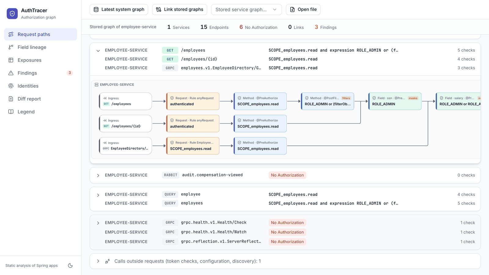
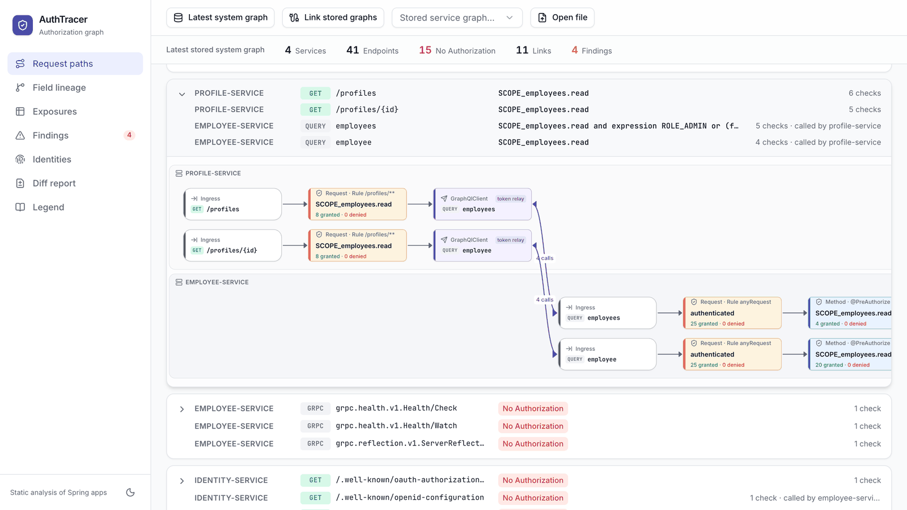
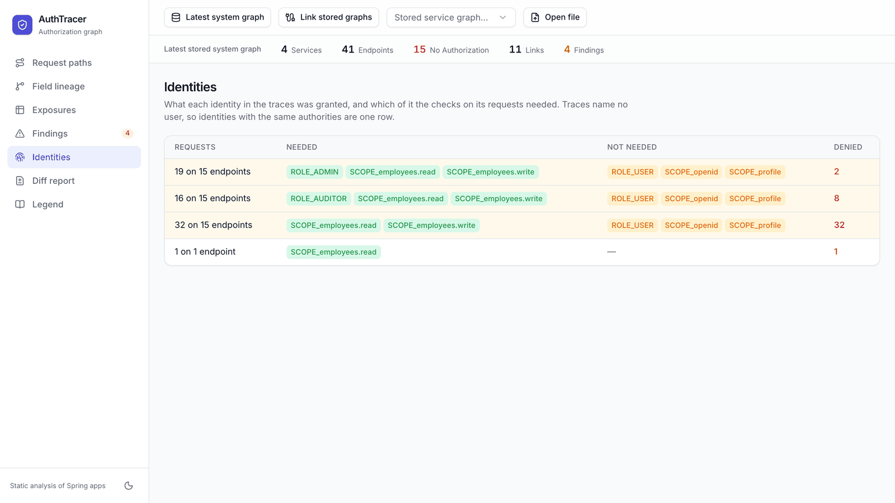
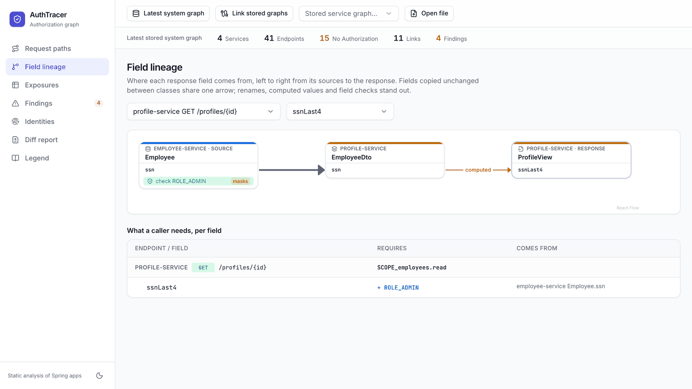
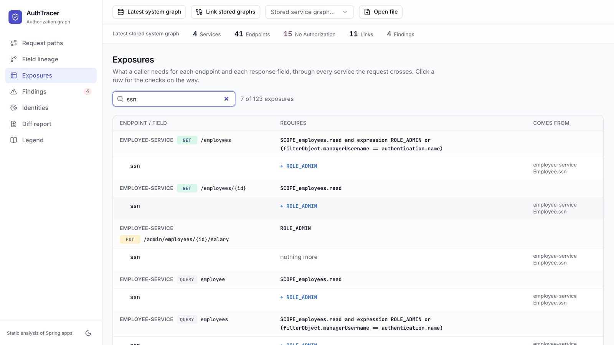
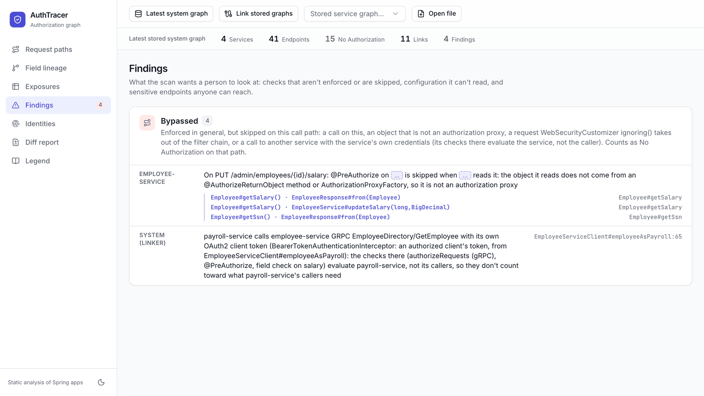
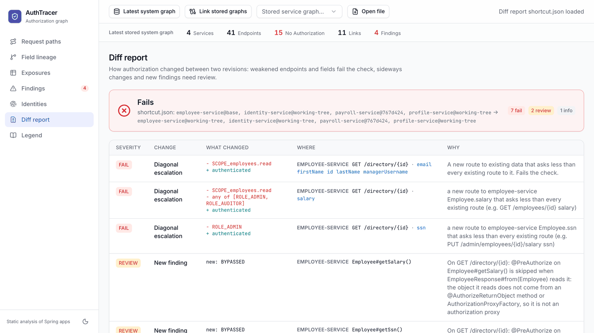

# Tutorial: from four services to a pull-request check

In about an hour you will scan four Spring services, link them into one system, add evidence from real traffic, follow
a sensitive field across services, and then watch AuthTracer fail a pull request that weakens it. Every command below
was run while writing this guide; outputs are shown where they matter.

**What you need:** JDK 25, Node.js 22.13 or newer (the server builds its UI with it; the command line needs only the
JDK), `git`, `curl`, Docker (for the services' Kafka and RabbitMQ), and about 4 GB of free memory for the services.

## 0. The example system

AuthTracer comes with four example services, in its `examples/` folder:

```
AuthTracer/
  examples/
    profile-service/  employee-service/  identity-service/  payroll-service/
```

| Service | Port | Role |
|---|---|---|
| **profile-service** | 8081 | The front service. Calls employee-service with the caller's token and derives fields from its answers (`ssnLast4`, `salaryBand`) |
| **employee-service** | 8082, gRPC 9082 | Owns the employee records and their sensitive fields, and uses most of Spring Security's method and field checks. Serves them over REST, GraphQL and gRPC |
| **identity-service** | 9000 | The identity provider (Spring Authorization Server). Issues the users' tokens the others accept, and payroll-service's own |
| **payroll-service** | 8083 | A reactive service (WebFlux). Calls employee-service and computes a payroll total from its salaries; keeps the salary changes it hears about |

Every service's own API is REST. Between them, the calls take every common way:

| From | To | Over | What |
|---|---|---|---|
| profile-service | employee-service | GraphQL | Profiles: the `employee` and `employees` queries, with the caller's token |
| profile-service | employee-service | REST | An employee's compensation, with the caller's token |
| profile-service | employee-service | RabbitMQ | Who viewed whose compensation, on the `audit.compensation-viewed` queue |
| payroll-service | employee-service | gRPC | Team leads and salaries: `EmployeeDirectory/GetEmployee`, with the caller's token |
| payroll-service | employee-service | gRPC | The name of an employee whose salary changed, with payroll-service's own token |
| payroll-service | identity-service | REST | That token: client credentials, as the client `payroll-service`, for the one scope `employees.read` |
| employee-service | payroll-service | Kafka | Salary changes, on the `employee.salary-changed` topic |

A message carries no token: its listener runs with no one signed in, and who acted travels in the message itself.
So when payroll-service's Kafka listener needs the employee's name, it asks identity-service for a token of its own.
Kafka and RabbitMQ run in Docker, from `scripts/brokers.compose.yaml`.

The users are `alice` and `bob` (`ROLE_USER`), `carol` (`ROLE_USER`, `ROLE_AUDITOR`) and `admin` (`ROLE_USER`,
`ROLE_ADMIN`), all with the password `password`.

All commands run from the `AuthTracer` directory unless they say otherwise.

## 1. Start AuthTracer

```
./gradlew bootRun
```

The first build also builds the UI. When the log says `Started AuthTracerApplication`, open http://localhost:8080.
Nothing is stored yet, and the page says so: it shows graphs that are published to it, or any graph file you open.

## 2. Scan your first service

A scan reads a service's compiled code. It never runs the service. In a second terminal:

```
./gradlew authtracer --args="scan --project examples/employee-service --out build/graphs/employee-service.json --publish http://localhost:8080"
```

```
INFO  ApplicationScanner - Scanned employee-service (45 application classes) in 496 ms: 67 nodes, 34 edges, 3 findings
INFO  CliRunner - Wrote employee-service graph (revision 52e6713) to .../AuthTracer/build/graphs/employee-service.json
INFO  CliRunner - Published employee-service graph to http://localhost:8080/api/graphs
```

The first scan of a project takes longer: it resolves the project's classpath and compiles it if needed. (The count
includes the classes protobuf generates for employee-service's gRPC service.)

The graph is in `build/graphs/employee-service.json`, and `--publish` stored it on the server too. In the UI, pick
**employee-service** from **Stored service graph** at the top.



**Request paths** lists every endpoint with what a caller needs to get it. Endpoints whose paths end the same way share
a card, so you read what's different, not the same thing five times. Open a card:

- Each box is a step, left to right in the order it runs. **Amber** steps are request rules from the filter chain,
  **blue** ones are method checks such as `@PreAuthorize`, **green** ones guard a single field, **violet** ones call
  another service.
- A **dashed** arrow means the next step runs on some branches only.
- Click any step to see its details on the right: what it requires, how it was written, where it is in the code, and
  what happens when it denies.

The **Legend** view explains every shape and color.

## 3. Scan the rest, and link them

```
./gradlew authtracer --args="scan --project examples/profile-service --out build/graphs/profile-service.json --publish http://localhost:8080"
./gradlew authtracer --args="scan --project examples/identity-service --out build/graphs/identity-service.json --publish http://localhost:8080"
./gradlew authtracer --args="scan --project examples/payroll-service --out build/graphs/payroll-service.json --publish http://localhost:8080"
```

identity-service has no controllers of its own: its endpoints (`/oauth2/token`, `/oauth2/jwks`, `/userinfo`...) are
registered by Spring Authorization Server, and AuthTracer knows what each of them requires.

Now press **Link stored graphs**. AuthTracer matches every outgoing call to the endpoint it reaches: a REST call by
its URL, a GraphQL query by its operation, a gRPC call by its method, a message by its topic or queue. The paths now
cross services: profile-service's `GET /profiles/{id}` runs its own rule, queries employee-service, and
employee-service's checks run before profile-service's next step. Calls matched from the code alone are **inferred**
and drawn dashed.

A step that sends a message says **no caller**: its listener runs with no one signed in, so the checks after it
don't count for the sender's callers. employee-service's `PUT /admin/employees/{id}/salary` ends in a Kafka send, and
payroll-service's listener for it shows **No Authorization**: whoever can write to the topic reaches it. The listener
then calls employee-service with payroll-service's own token, and that call's step says **OAuth2**: employee-service's
checks on it evaluate payroll-service, not anyone who reads what the listener keeps. Click it for the token: the client
it is issued to, the scopes it asks for, and where from.

## 4. Add evidence from real traffic

Static analysis says what can happen. Traces say what did. Start the brokers, the trace store and the services, each
in its own terminal, waiting for each to be up:

| | Command | Up when |
|---|---|---|
| 0 | `docker compose -f scripts/brokers.compose.yaml up -d --wait` | It returns: Kafka on 9092 and RabbitMQ on 5672 are healthy |
| 1 | `./gradlew runZipkin` | `curl -s localhost:9411/health` answers |
| 2 | `cd examples/identity-service && ./gradlew bootRun` | `curl -s localhost:9000/.well-known/openid-configuration` answers |
| 3 | `cd examples/employee-service && ./gradlew bootRun` | `curl -s localhost:8082/actuator/health` says `UP` |
| 4 | `cd examples/profile-service && ./gradlew bootRun` | `curl -s localhost:8081/actuator/health` says `UP` |
| 5 | `cd examples/payroll-service && ./gradlew bootRun` | `curl -s localhost:8083/actuator/health` says `UP` |

Then send some traffic as each user:

```
scripts/traffic.sh
```

```
alice  GET  8081/profiles/1                            200  {"employeeId":1,"displayName":"Alice Anders","contact":{"email":"alice@example.com"},"salaryBand":"UNDISCLOSED","ssnLast4":"****"}
alice  GET  8081/profiles                              200  []
alice  GET  8081/admin/compensation/1                  403
alice  GET  8082/employees/2                           200  {"id":2,"firstName":"Bob","lastName":"Brown","email":"bob@example.com","ssn":"***-**-****","salary":null,"managerUsername":"admin"}
alice  POST 8082/graphql                               200  {"data":{"employee":{"email":"bob@example.com","ssn":"***-**-****","salary":null}}}
...
admin  GET  8081/profiles/1                            200  {"employeeId":1,"displayName":"Alice Anders","contact":{"email":"alice@example.com"},"salaryBand":"BAND_2","ssnLast4":"6789"}
...
carol  GET  8082/audit/employees/1/views               200  [{"employeeId":1,"viewedBy":"admin","at":"2026-10-18T07:08:21.754349Z"}]
...
admin  GET  8083/payroll/changes                       200  [{"employeeId":1,"employeeName":"Alice Anders","previous":85000,"current":85000,"changedBy":"admin","at":"2026-10-18T07:08:21.819506Z"}]
```

One line per call: the user, the call, the status, and the start of the response.

Notice what the responses already tell you: employee-service masks the SSN for everyone but `admin`, over REST and
GraphQL alike, so profile-service's `ssnLast4` is `"****"` for them. The last lines read what the listeners kept: the
admin's look at a salary reached the audit over RabbitMQ, and the admin's salary update reached payroll over Kafka,
with the employee's name, which payroll-service read from employee-service with its own token. Wait five seconds for
the traces to arrive, then press **Link stored graphs** again.



- Calls seen in the traces are **observed**: solid violet arrows with a call count. So are messages, when the traces
  show the listener's span under the send's.
- Every check shows how often it **granted** and **denied**.
- The **Identities** view shows what each identity was granted and which of it its requests actually needed. Every
  user's token here carries `ROLE_USER` and the OpenID scopes, and no check asked for them: over-scoped test
  identities. payroll-service's own token is the one that holds only what it needs: `SCOPE_employees.read`.



The same from the command line, to a file:

```
./gradlew authtracer --args="link --graphs build/graphs/profile-service.json,build/graphs/employee-service.json,build/graphs/identity-service.json,build/graphs/payroll-service.json --zipkin http://localhost:9411 --out build/graphs/system.json"
./gradlew authtracer --args="identities --graph build/graphs/system.json"
```

## 5. Follow a sensitive field

Why does profile-service's `ssnLast4` need `ROLE_ADMIN`, when nothing in profile-service asks for it? Open **Field
lineage**, pick `profile-service GET /profiles/{id}` and the field `ssnLast4`.



Read it left to right:

1. employee-service's `Employee.ssn` carries a field check: **ROLE_ADMIN, masks** (a non-admin gets a masked value, not
   an error).
2. employee-service's GraphQL `employee` query answers with the `Employee` itself, so the value crosses the network
   unchanged into profile-service's `EmployeeDto`...
3. ...and is **computed** into `ProfileView.ssnLast4`.

A computed field inherits the checks on everything it is computed from. So the real value of `ssnLast4` needs everything
on the way: profile-service's rule, employee-service's rules and method check, and the field check. The table under the
diagram says it in one line, and **Exposures** says it for every endpoint and field at once. Filter it by `ssn`:



A field row shows only what it asks **beyond** its endpoint (`+ ROLE_ADMIN`), so the fields with their own checks
stand out. Click a row for every check on the way. From the command line:

```
./gradlew authtracer --args="exposures --graph build/graphs/system.json --field ssn"
```

Lineage crosses messages too. Pick `payroll-service GET /payroll/changes` and the field `previous`: payroll-service
serves what its Kafka listener keeps of each `SalaryChange` it receives, and employee-service built each one from
`Employee.salary`, so that is where the value comes from. A message carries no caller, so employee-service's checks
don't count for payroll-service's readers; the field's sources and labels do. The listener also reads the employee's
name from employee-service, with payroll-service's own token, and lineage follows that call: `employeeName` comes from
employee-service's `Employee.firstName` and `lastName`. No caller is behind that call either, so employee-service's
checks on it don't count for the name's readers. The same goes for employee-service's audit listener, which copies each
of profile-service's `CompensationViewed` events into a `CompensationView`: `GET /audit/employees/{id}/views`'
`viewedBy` comes from profile-service's event.

## 6. Read the findings

**Findings** lists what the scan wants a person to look at. In the example system, employee-service's admin salary
update reads `getSalary()` and `getSsn()` on an object that is not an authorization proxy, so the field checks on them
never run on that path. AuthTracer reports that as **Bypassed** and counts the field as unchecked there.

Once the services are linked, one more **Bypassed** finding is the system's: payroll-service's listener calls
employee-service with its own token, so the checks there evaluate payroll-service, not its callers. That's by design
here, as the listener has no caller, and it's why identity-service registers payroll-service's client for only
`employees.read`. AuthTracer reads both sides of that token: had the registration asked for a scope identity-service
doesn't grant that client, or had employee-service's path asked for one the token lacks, a **Token rejected** finding
would say the call fails.



## 7. Check a pull request

This is what AuthTracer is for day to day: a change that weakens authorization fails the build, with a report that
says what got weaker and where.

Work on a copy of employee-service, so the original stays as it is:

```
mkdir -p build/experiments
copy() { rsync -a --exclude build --exclude .gradle --exclude .git examples/employee-service/ "build/experiments/$1/"; }
```

### A weakened field check fails

Change the SSN's field check from `hasRole('ADMIN')` to `isAuthenticated()`:

```
copy employee-service-weakened
perl -pi -e "s/\@PreAuthorize\(\"hasRole\('ADMIN'\)\"\)/\@PreAuthorize(\"isAuthenticated()\")/" build/experiments/employee-service-weakened/src/main/java/dev/crain/employeeservice/employee/Employee.java
./gradlew authtracer --args="diff --project build/experiments/employee-service-weakened --base-project examples/employee-service --context build/graphs/system.json --json build/reports/authtracer/weakened.json"
```

```
Result: **FAIL** (6 weakened)
| FAIL | WEAKENED | employee-service | `GET /employees` | `ssn` | ... and ROLE_ADMIN | ... (no ROLE_ADMIN) |
| FAIL | WEAKENED | employee-service | `GET /employees/{id}` | `ssn` | SCOPE_employees.read and ROLE_ADMIN | SCOPE_employees.read |
| FAIL | WEAKENED | employee-service | `QUERY employee` | `ssn` | SCOPE_employees.read and ROLE_ADMIN | SCOPE_employees.read |
| FAIL | WEAKENED | employee-service | `QUERY employees` | `ssn` | ... and ROLE_ADMIN | ... (no ROLE_ADMIN) |
| FAIL | WEAKENED | profile-service | `GET /profiles` | `ssnLast4` | ... and ROLE_ADMIN | ... (no ROLE_ADMIN) |
| FAIL | WEAKENED | profile-service | `GET /profiles/{id}` | `ssnLast4` | SCOPE_employees.read and ROLE_ADMIN | SCOPE_employees.read |
```

The command exits with 1. One field check guards `ssn` wherever it goes out: the REST endpoints and the GraphQL
queries both got weaker. (The gRPC record has no `ssn`.) Look at the profile-service rows: nobody touched
profile-service, but its `ssnLast4` got weaker, because `--context` brought the other services in. Without it, only
employee-service's rows appear.

### A shortcut that skips the checks fails

A new endpoint that reads employees straight from the repository, skipping the service whose methods carry the checks:

```
copy employee-service-shortcut
mkdir -p build/experiments/employee-service-shortcut/src/main/java/dev/crain/employeeservice/directory
cat > build/experiments/employee-service-shortcut/src/main/java/dev/crain/employeeservice/directory/DirectoryController.java <<'EOF'
package dev.crain.employeeservice.directory;

import dev.crain.employeeservice.employee.EmployeeRepository;
import dev.crain.employeeservice.employee.EmployeeResponse;
import org.springframework.web.bind.annotation.GetMapping;
import org.springframework.web.bind.annotation.PathVariable;
import org.springframework.web.bind.annotation.RestController;

@RestController
class DirectoryController {

    private final EmployeeRepository repository;

    DirectoryController(EmployeeRepository repository) {
        this.repository = repository;
    }

    @GetMapping("/directory/{id}")
    EmployeeResponse get(@PathVariable long id) {
        return EmployeeResponse.from(repository.findById(id).orElseThrow());
    }
}
EOF
./gradlew authtracer --args="diff --project build/experiments/employee-service-shortcut --base-project examples/employee-service --context build/graphs/system.json --json build/reports/authtracer/shortcut.json"
```

```
Result: **FAIL** (7 diagonal escalation, 2 new finding, 1 new exposure)
```

- **Diagonal escalation**, for every field of `GET /directory/{id}`: a new way to the same data that asks less than
  every existing way (`authenticated`, where the others ask for `SCOPE_employees.read` and, for `ssn`, `ROLE_ADMIN`).
- **New finding** (twice): the field checks on `getSsn()` and `getSalary()` are bypassed, because the object doesn't
  come through an authorization proxy.

Open the report in the UI: **Open file**, then `build/reports/authtracer/shortcut.json`. The **Diff report** view puts
the failures first and shows one row per distinct change, with every place it applies.



### A change that is still covered passes

Removing a check that the filter chain already enforces isn't a weakening. employee-service's salary update has
`@RolesAllowed("ADMIN")`, but `/admin/**` already needs `hasRole('ADMIN')`:

```
copy employee-service-covered
perl -0pi -e 's/    \@RolesAllowed\("ADMIN"\)\n//' build/experiments/employee-service-covered/src/main/java/dev/crain/employeeservice/employee/EmployeeService.java
./gradlew authtracer --args="diff --project build/experiments/employee-service-covered --base-project examples/employee-service --context build/graphs/system.json"
```

```
Result: **Pass**
No authorization changes.
```

### Against a git revision, as a build step

In a pipeline the base is a git revision: the pull request's target branch. AuthTracer checks it out in a temporary
`git worktree`, scans it next to the working tree and compares. Try it on a throwaway repository with the weakened
check left uncommitted:

```
copy employee-service-git
(cd build/experiments/employee-service-git && git init -q && git add -A && git -c user.email=me@localhost -c user.name=me commit -qm base)
perl -pi -e "s/\@PreAuthorize\(\"hasRole\('ADMIN'\)\"\)/\@PreAuthorize(\"isAuthenticated()\")/" build/experiments/employee-service-git/src/main/java/dev/crain/employeeservice/employee/Employee.java
./gradlew authtracerDiff -PdiffProject=build/experiments/employee-service-git -PbaseRef=HEAD -Pcontext=build/graphs/system.json -Psarif=build/reports/authtracer/diff.sarif
```

```
Checking out HEAD of .../build/experiments/employee-service-git to scan it
Result: **FAIL** (6 weakened)
BUILD FAILED
```

The Markdown report is in `build/reports/authtracer/diff.md`. The SARIF file points all six failures at line 49 of
`Employee.java`, the line that changed: uploaded to GitHub code scanning, they appear on that line of the pull request.
In a real pipeline `-PbaseRef` is the target branch, e.g. `origin/main`. The [reference](reference.md#on-github) has
the workflow, and a hook that runs the same check when a coding agent finishes a change.

## 8. Tell AuthTracer what it can't know

Some things aren't in the code: which data is sensitive, a hand-rolled check a person has reviewed, a rule enforced by
a gateway. A service declares them in `authtracer.yaml` at its root. Try it on another copy:

```
copy employee-service-facts
cat > build/experiments/employee-service-facts/authtracer.yaml <<'EOF'
version: 1
facts:
  - kind: sensitive
    field: dev.crain.employeeservice.employee.Employee.salary
    labels: [CONFIDENTIAL]
  - kind: requirement
    ingress: "GET /audit/**"
    requirement: "Only reachable through the audit VPN"
policies:
  - label: CONFIDENTIAL
    requires: "hasRole('ADMIN')"
EOF
./gradlew authtracer --args="scan --project build/experiments/employee-service-facts --out build/experiments/employee-service-facts.json"
./gradlew authtracer --args="link --graphs build/graphs/profile-service.json,build/experiments/employee-service-facts.json,build/graphs/identity-service.json,build/graphs/payroll-service.json --out build/experiments/system-facts.json"
./gradlew authtracer --args="policies --graph build/experiments/system-facts.json"
```

```
| employee-service | `GET /employees`      | `salary`     | CONFIDENTIAL | ROLE_ADMIN | SCOPE_employees.read and expression ... and any of [ROLE_ADMIN, ROLE_AUDITOR] |
| employee-service | `GET /employees/{id}` | `salary`     | CONFIDENTIAL | ROLE_ADMIN | SCOPE_employees.read and any of [ROLE_ADMIN, ROLE_AUDITOR] |
| employee-service | `GRPC employees.v1.EmployeeDirectory/GetEmployee` | `salary` | CONFIDENTIAL | ROLE_ADMIN | SCOPE_employees.read and any of [ROLE_ADMIN, ROLE_AUDITOR] |
| employee-service | `QUERY employee`      | `salary`     | CONFIDENTIAL | ROLE_ADMIN | SCOPE_employees.read and any of [ROLE_ADMIN, ROLE_AUDITOR] |
| employee-service | `QUERY employees`     | `salary`     | CONFIDENTIAL | ROLE_ADMIN | SCOPE_employees.read and expression ... and any of [ROLE_ADMIN, ROLE_AUDITOR] |
| profile-service | `GET /profiles`       | `salaryBand` | CONFIDENTIAL | ROLE_ADMIN | SCOPE_employees.read and expression ... and any of [ROLE_ADMIN, ROLE_AUDITOR] |
| profile-service | `GET /profiles/{id}`  | `salaryBand` | CONFIDENTIAL | ROLE_ADMIN | SCOPE_employees.read and any of [ROLE_ADMIN, ROLE_AUDITOR] |
```

The command exits with 1: the salary's field check lets auditors read it too, over REST, GraphQL and gRPC, and the
policy says only admins may.
Open `build/experiments/system-facts.json` with **Open file** and filter **Exposures** by `CONFIDENTIAL`:

- The label travels with the data: profile-service's `salaryBand` and payroll-service's payroll `total`, both computed
  from the salary, are CONFIDENTIAL too.
- So does the policy. employee-service owns the salary, so its policy holds wherever the salary goes: profile-service's
  `salaryBand` fails it too, because nothing on its way asks for more than the salary's field check, which lets auditors
  in. payroll-service's `total` passes, because its payroll endpoint asks for `ROLE_ADMIN` itself.
- A service's endpoint policies (`endpoint: "PUT /admin/**"`) stay with its own routes. To set rules for every
  service, put them in an **Org file** (passed with `--org-facts`). Policies only add up, so a service can make the
  Org's stricter but never relax it, and Org facts win over a service's own, so a service can't quietly declassify
  what the organization marked sensitive.
- `GET /audit/employees/{id}` now starts with a **Provided requirement** step: the VPN rule, which no code shows.

The [reference](reference.md#provided-facts) has every kind of fact and how they combine.

## 9. Clean up

Stop the services and Zipkin with Ctrl+C, and the brokers with
`docker compose -f scripts/brokers.compose.yaml down`. AuthTracer keeps its graphs in `./data`; delete it to start
over.
`build/experiments` holds the copies from part 7.

## Where next

- [Reference](reference.md): every command, task, endpoint and fact.
- [Onboarding](onboarding.md): how AuthTracer works inside, for people changing it.
- [`video/authtracer-tour.mp4`](video/authtracer-tour.mp4): a captioned tour of the UI; `guide/video/make_video.py`
  records it again from your own data (see its header).
- `scripts/demo.sh` (IntelliJ: the **demo** run configuration) does parts 1 to 4 in one go, for a demo.
